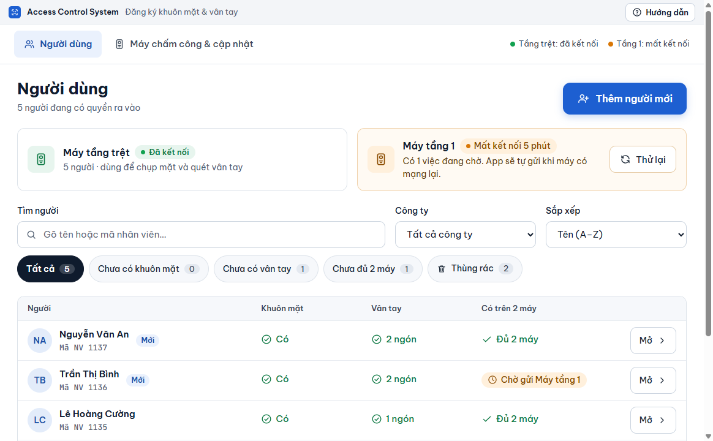

# Giới thiệu

**Access Control System** giúp bạn đăng ký khuôn mặt và vân tay cho nhân viên vào hai máy kiểm soát ra vào Hikvision. Bạn chỉ nhập một lần trên máy tính; phần mềm tự gửi xuống cả hai máy, đọc lại để chắc chắn máy đã nhận, và giữ một bản gốc để gửi lại khi máy bị reset hoặc thay máy mới.

<a href="bat-dau/cai-dat.md" class="button primary">Cài đặt</a> <a href="bat-dau/thiet-lap-lan-dau.md" class="button secondary">Thiết lập lần đầu</a>

<figure><figcaption>
Tab Người dùng
</figcaption></figure>

## Tính năng chính

* **Nhập một lần, có trên cả hai máy**: thêm người theo 4 bước (thông tin, khuôn mặt, vân tay, hoàn tất), phần mềm tự gửi xuống từng máy.
* **Biết chắc máy đã nhận**: sau khi gửi, phần mềm đọc lại từ máy. Danh sách cho biết ai đã **Đủ 2 máy**, ai còn **Chờ gửi**.
* **Máy mất mạng không làm mất việc**: việc chưa gửi được nằm trong hàng đợi và tự gửi khi máy có mạng lại.
* **Chụp mặt ngay tại máy chấm công**: hoặc dùng webcam, hoặc chọn ảnh có sẵn. Quét vân tay trên máy và biết chất lượng ngay.
* **So khớp 2 máy**: xem trước hai máy lệch nhau chỗ nào, bằng lời dễ hiểu, rồi bổ sung phần thiếu. Phần mềm chỉ gỡ người khỏi máy khi bạn chọn.
* **Khoá ra vào, mở lại, xoá hẳn**: người nghỉ việc được khoá trên máy mà dữ liệu vẫn giữ, mở lại không phải chụp lại.
* **Dữ liệu an toàn**: dữ liệu mã hoá trên máy tính, tự sao lưu, khôi phục được trên máy tính mới bằng mật khẩu sao lưu.
* **Cập nhật một chạm**: có bản mới thì bấm **Cập nhật ngay**, dữ liệu giữ nguyên.

## Bắt đầu từ đâu

<table data-view="cards">
  <thead>
    <tr>
      <th></th>
      <th></th>
      <th data-hidden data-card-target data-type="content-ref"></th>
    </tr>
  </thead>
  <tbody>
    <tr>
      <td><strong>Cài đặt</strong></td>
      <td>Tải bộ cài từ GitHub, cài lên máy tính, không cần quyền quản trị.</td>
      <td><a href="bat-dau/cai-dat.md">cai-dat.md</a></td>
    </tr>
    <tr>
      <td><strong>Thiết lập lần đầu</strong></td>
      <td>Thêm hai máy, lấy dữ liệu đang có, đặt mật khẩu sao lưu, So khớp 2 máy.</td>
      <td><a href="bat-dau/thiet-lap-lan-dau.md">thiet-lap-lan-dau.md</a></td>
    </tr>
    <tr>
      <td><strong>Thêm người mới</strong></td>
      <td>Đăng ký thông tin, khuôn mặt và vân tay cho một người.</td>
      <td><a href="nguoi-dung/them-nguoi-moi.md">them-nguoi-moi.md</a></td>
    </tr>
    <tr>
      <td><strong>Xử lý sự cố</strong></td>
      <td>Máy mất kết nối, sai mật khẩu, máy từ chối ảnh mặt hoặc vân tay.</td>
      <td><a href="tham-khao/xu-ly-su-co.md">xu-ly-su-co.md</a></td>
    </tr>
  </tbody>
</table>

## Yêu cầu hệ thống

| | Tối thiểu |
| --- | --- |
| Hệ điều hành | Windows 10 hoặc Windows 11, bản 64-bit |
| Máy chấm công | Máy kiểm soát ra vào Hikvision có ISAPI, cùng mạng nội bộ với máy tính |
| Khác | Microsoft Edge WebView2 (Windows 11 và Windows 10 đã cập nhật thường có sẵn); Internet khi cập nhật phần mềm |


Phần mềm đã chạy trên hai máy DS-K1T9342MFWX thật (phần mềm máy V4.39): kết nối, lấy dữ liệu 157 người kèm khuôn mặt và vân tay, So khớp, hình camera trực tiếp (cả lúc máy đang chụp). Máy nhận lệnh chụp khuôn mặt và quét vân tay qua mạng; một lần đăng ký trọn vẹn với người thật (chụp được mặt, quét được ngón) chưa được ghi nhận. Dùng model máy khác thì nhờ IT chạy công cụ kiểm tra tại chỗ theo trang [Kiểm tra máy thật bằng Probe](tham-khao/probe.md).


Tài liệu này viết cho phiên bản 0.9.11. Phần mềm là mã nguồn mở, giấy phép MIT: [github.com/tdphuong97/AccessControlSystem](https://github.com/tdphuong97/AccessControlSystem).
