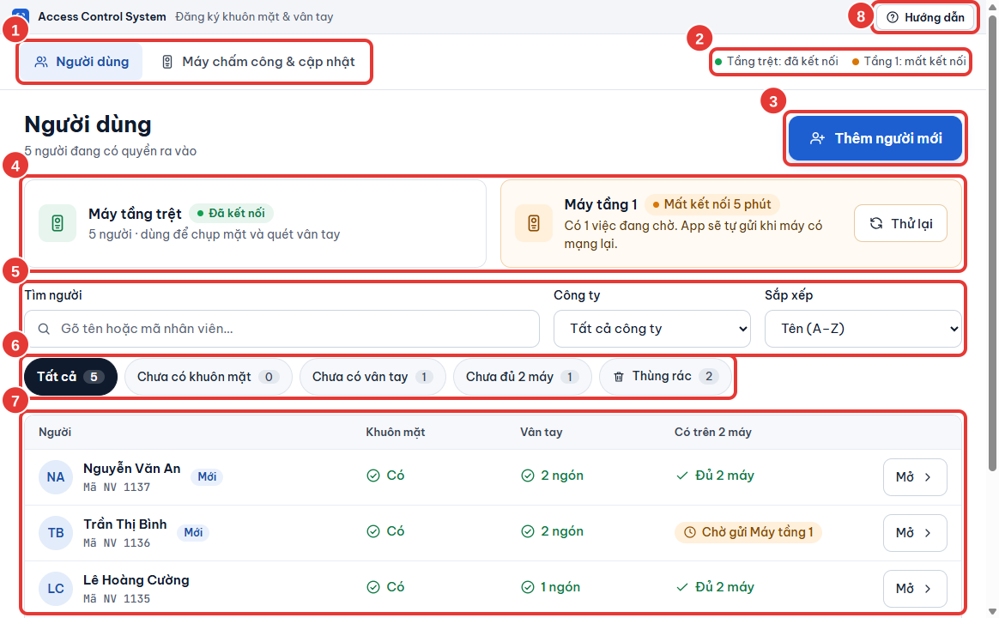
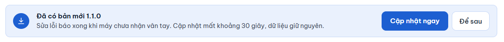

# Làm quen giao diện

Phần mềm có hai tab. Tab **Người dùng** là nơi bạn làm việc hằng ngày: thêm, tìm, sửa và khoá người. Tab **Máy chấm công & cập nhật** dùng khi cần: thêm máy, **So khớp 2 máy**, sao lưu, cập nhật phần mềm.

<figure><figcaption>
Các vùng trên tab Người dùng
</figcaption></figure>

| Số | Vùng | Dùng để |
| --- | --- | --- |
| 1 | Hai tab **Người dùng** và **Máy chấm công & cập nhật** | Chuyển giữa công việc hằng ngày và phần cài đặt máy. |
| 2 | Chấm trạng thái máy, ví dụ **Tầng trệt: đã kết nối** | Xem nhanh từng máy có đang kết nối không. Luôn hiện ở góc trên bên phải, dù bạn đang ở màn hình nào. |
| 3 | **Thêm người mới** | Bắt đầu đăng ký một người: thông tin, khuôn mặt, vân tay. |
| 4 | Thẻ máy | Trạng thái chi tiết của từng máy: số người, máy dùng để chụp mặt hay quét vân tay, số việc đang chờ. Máy mất kết nối có nút **Thử lại**. |
| 5 | Ô **Tìm người** | Gõ tên hoặc mã nhân viên. Không cần gõ dấu: gõ `nguyen` vẫn ra "Nguyễn". |
| 6 | Bộ lọc **Tất cả**, **Chưa có khuôn mặt**, **Chưa có vân tay**, **Chưa đủ 2 máy**, **Đã khoá** | Lọc nhanh những người cần bổ sung. Con số bên cạnh là số người trong mỗi nhóm. Bộ lọc **Đã khoá** chỉ hiện khi có người đã khoá. |
| 7 | Danh sách người | Mỗi dòng cho biết người đó đã có khuôn mặt, vân tay chưa và đã có trên mấy máy. Bấm **Có** hoặc số ngón để xem nhanh ảnh mặt và vân tay; bấm **Mở** để xem chi tiết. Ô **Công ty** cạnh ô tìm kiếm lọc theo công ty. Danh sách chia trang, mặc định 50 người; đổi ở ô **Mỗi trang** cuối bảng. |
| 8 | **Hướng dẫn** | Mở tài liệu này ngay trong phần mềm, đúng trang của màn hình đang dùng. Phím tắt `F1`. Bấm **Đóng** để quay lại. |


Cả giao diện to nhỏ theo cửa sổ: kéo cửa sổ to ra hoặc phóng to toàn màn hình thì chữ và nút to theo; thu nhỏ cửa sổ thì nhỏ theo. Ở cỡ cửa sổ mặc định, giao diện giữ đúng cỡ chữ gốc.


## Chấm trạng thái máy

| Chấm | Ý nghĩa | Bạn cần làm gì |
| --- | --- | --- |
| Xanh lá, **đã kết nối** | Máy đang nối mạng với phần mềm. | Không cần làm gì. |
| Cam, **mất kết nối** | Phần mềm không liên lạc được với máy. Việc gửi cho máy đó nằm trong hàng đợi và tự gửi khi máy có mạng lại. | Kiểm tra điện và dây mạng của máy. Xem [Theo dõi việc gửi xuống máy](../may-cham-cong/theo-doi-gui-xuong-may.md). |
| Đỏ, **sai mật khẩu** | Máy từ chối mật khẩu. Phần mềm dừng gửi ngay để máy không khoá địa chỉ IP. | Sửa mật khẩu ở tab **Máy chấm công & cập nhật**. Xem [Thêm và sửa máy chấm công](../may-cham-cong/them-sua-may.md). |

## Nhãn ở cột "Có trên 2 máy"

| Nhãn | Ý nghĩa |
| --- | --- |
| **Đủ 2 máy** | Cả hai máy đã nhận và phần mềm đã đọc lại để chắc chắn. |
| **Chờ gửi** kèm tên máy, ví dụ **Chờ gửi Máy tầng 1** | Còn việc chưa gửi xong cho máy đó, thường vì máy đang mất kết nối. Phần mềm tự gửi tiếp. |
| **Lỗi gửi, mở để xem** | Máy từ chối một phần dữ liệu, ví dụ ảnh mặt quá mờ. Bấm **Mở** để xem lý do và cách xử lý. |
| **Đã khoá ra vào** | Người này đã bị khoá. Xem [Khoá ra vào và mở lại](../nguoi-dung/khoa-va-mo-lai.md). |

Nhãn **Mới** cạnh tên là người vừa thêm trong 7 ngày gần đây.


Khi có máy mới, máy vừa đổi địa chỉ, vừa khôi phục hoặc vừa lấy dữ liệu, tab **Người dùng** hiện dòng nhắc chạy **So khớp 2 máy**. Bấm **Mở So khớp 2 máy** trong dòng nhắc đó để gửi đủ dữ liệu cho mọi máy.


## Thanh "Đã có bản mới"

Khi có phiên bản mới, đầu tab **Người dùng** hiện một thanh như sau:

<figure><figcaption></figcaption></figure>

Bấm **Cập nhật ngay** để sang phần cập nhật, hoặc **Để sau** để ẩn thanh này. Xem [Cập nhật phần mềm](../may-cham-cong/cap-nhat-phan-mem.md).

## Phần mềm chạy ở khay hệ thống

Bấm nút đóng cửa sổ không tắt phần mềm. Phần mềm thu xuống khay hệ thống (góc phải thanh tác vụ, cạnh đồng hồ) và vẫn gửi những việc còn chờ. Lần đầu thu xuống sau mỗi lần mở, phần mềm báo **Phần mềm vẫn chạy ở khay hệ thống để gửi dữ liệu còn chờ.**

- Để mở lại cửa sổ: bấm biểu tượng ở khay, hoặc bấm chuột phải rồi chọn **Mở**. Mở phần mềm thêm lần nữa từ menu Start cũng chỉ đưa cửa sổ cũ lên, không mở thêm bản thứ hai.
- Để tắt hẳn: bấm chuột phải vào biểu tượng ở khay, chọn **Thoát**. Việc còn chờ được giữ lại và gửi tiếp ở lần mở sau.

Biểu tượng ở khay cũng báo khi máy mất kết nối hoặc có lại kết nối, khi máy báo sai mật khẩu, khi có dữ liệu gửi bị lỗi và khi đã gửi xong mọi việc còn chờ.
