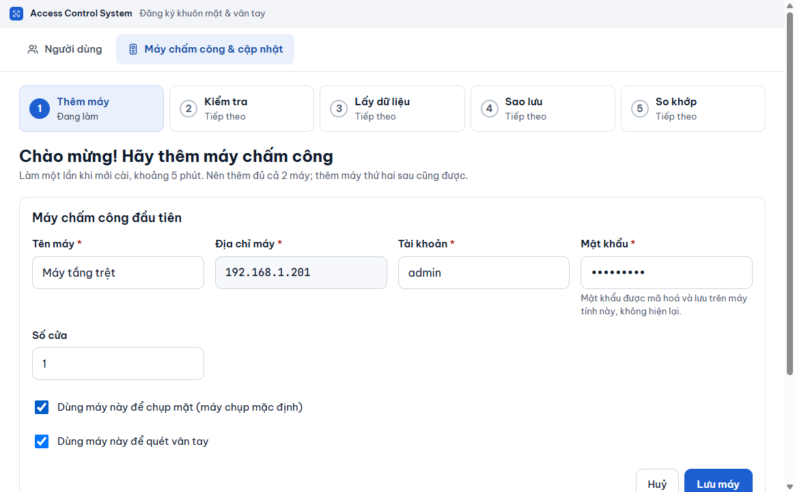
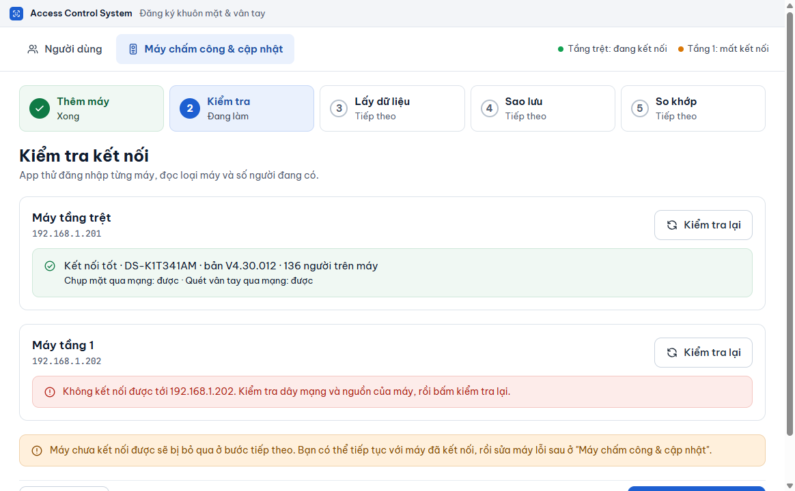
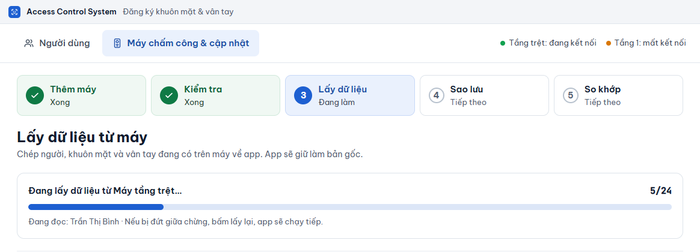
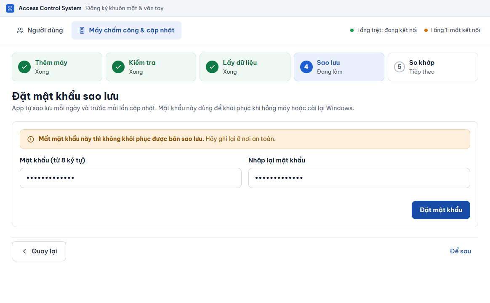
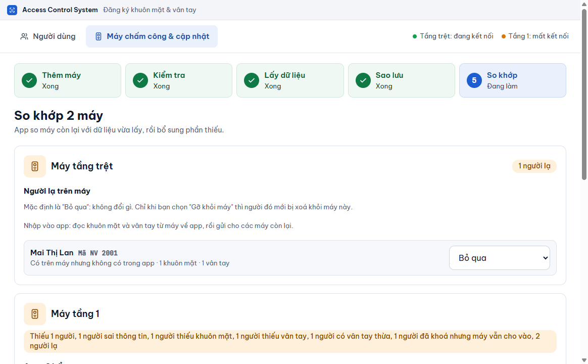

# Thiết lập lần đầu

**Ai làm:** người quản lý phần mềm (IT) · **Mất khoảng:** 5 phút


**Trước khi bắt đầu:** chuẩn bị cho mỗi máy chấm công: địa chỉ IP (ví dụ `192.168.1.201`), tài khoản và mật khẩu đăng nhập máy. Máy tính này phải cùng mạng với hai máy. Nghĩ trước một **mật khẩu sao lưu** (ít nhất 8 ký tự) và nơi ghi lại nó.


Màn hình **Chào mừng! Hãy thêm máy chấm công** hiện ra ngay khi bạn mở phần mềm lần đầu. Phía trên có thanh 5 bước: **Thêm máy**, **Kiểm tra**, **Lấy dữ liệu**, **Sao lưu**, **So khớp**. Bước đã xong có dấu tích.


Cài lại phần mềm trên máy tính mới và đã có file sao lưu `.acsbak`? Bỏ qua trình hướng dẫn, làm theo [Sao lưu và khôi phục](../may-cham-cong/sao-luu-khoi-phuc.md).




### Thêm máy

Bấm **Thêm máy**. Ô nhập hiện ra. Ô có dấu \* là bắt buộc.

| Ô | Điền gì |
| --- | --- |
| **Tên máy** \* | Tên dễ nhớ, ví dụ `Máy tầng trệt`. |
| **Địa chỉ máy** \* | Chỉ số IP, ví dụ `192.168.1.201`. Không gõ `http://` và không có dấu cách. |
| **Tài khoản** \* | Tài khoản đăng nhập máy, thường là `admin`. |
| **Mật khẩu** \* | Mật khẩu của máy. Phần mềm mã hoá và không hiện lại. |
| **Số cửa** | Thường là `1`. |

Rồi đánh dấu vai trò của máy:

- Chọn **Dùng máy này để chụp mặt (máy chụp mặc định)** cho máy bạn sẽ đứng chụp khuôn mặt.
- Chọn **Dùng máy này để quét vân tay** cho máy có cảm biến vân tay. Ô này được chọn sẵn.

Bấm **Lưu máy**. Máy hiện trong danh sách với dấu tích xanh. Bấm **Thêm máy khác** để thêm máy thứ hai (nên thêm đủ cả hai máy; thêm máy thứ hai sau cũng được). Xong, bấm **Tiếp: Kiểm tra kết nối**.

<figure><figcaption></figcaption></figure>



### Kiểm tra kết nối

Phần mềm tự thử đăng nhập từng máy ngay khi bạn vào bước này; không cần bấm gì. Mỗi máy hiện một kết quả:

| Kết quả | Nghĩa là |
| --- | --- |
| **Đang kiểm tra kết nối…** | Đang thử, chờ vài giây. |
| **Kết nối tốt** kèm model, bản firmware và số người trên máy | Máy dùng được. Dòng nhỏ bên dưới cho biết **Chụp mặt qua mạng** và **Quét vân tay qua mạng** là **được** hay **chưa được**. |
| Khung đỏ có thông báo | Máy chưa dùng được. Đọc thông báo: thường là sai mật khẩu, sai địa chỉ IP hoặc máy chưa bật, chưa cắm mạng. |

Máy báo **chưa được** ở chụp mặt hoặc quét vân tay vẫn dùng được cho phần còn lại. Với lệnh chụp mặt, bạn dùng webcam hoặc ảnh có sẵn; xem [Chụp khuôn mặt](../nguoi-dung/chup-khuon-mat.md).

Để thử lại, bấm **Kiểm tra lại** ở máy đó. Để sửa thông tin máy, bấm **Sửa máy**. Máy chưa kết nối được sẽ bị bỏ qua ở bước sau; bạn có thể tiếp tục với máy đã kết nối rồi sửa máy lỗi sau, ở tab **Máy chấm công & cập nhật**. Nút **Tiếp: Lấy dữ liệu** chỉ bấm được khi có ít nhất một máy **Kết nối tốt**.

<figure><figcaption></figcaption></figure>



### Lấy dữ liệu có sẵn từ máy

Bước này chép người, khuôn mặt và vân tay đang có trên máy về phần mềm để làm bản gốc. Phần mềm chỉ đọc, không đổi gì trên máy.

1. Trong ô **Lấy dữ liệu từ máy nào?**, chọn máy đang có đầy đủ người nhất (máy tầng trệt trong ví dụ).
2. Bấm **Lấy dữ liệu từ máy này**.

Thanh tiến độ hiện **Đang lấy dữ liệu từ** tên máy, số người đã đọc và tên người đang đọc. Nên đợi ở màn hình này tới khi xong. Nếu lỡ chuyển sang tab khác, việc lấy vẫn chạy tiếp và tab **Người dùng** hiện tiến độ; khi đó làm nốt bước Sao lưu và So khớp ở tab **Máy chấm công & cập nhật**. Nếu bị đứt giữa chừng (mất mạng, máy tắt), bấm **Lấy lại dữ liệu**; phần mềm chạy tiếp, không bắt đầu lại từ đầu.

Khi xong, bạn thấy **Đã lấy** số người, số người có khuôn mặt và số vân tay. Có thể kèm cảnh báo vàng:

- Một số người "đã có mặt trên máy nhưng app chưa có ảnh": máy đó không cho tải ảnh gốc. Người này vẫn vào được máy đang có mặt; cần chụp lại một lần nếu muốn gửi sang máy kia.
- "Không đọc được đủ dữ liệu của N người": bấm **Mở Nhật ký** để xem người nào, rồi chạy lại bước này nếu cần.

Bấm **Tiếp: Sao lưu**. Nếu máy còn trống và bạn muốn bắt đầu từ danh sách trống, bấm **Bỏ qua, bắt đầu từ danh sách trống**. Lỡ bỏ qua bước này khi máy đã có người thì làm lại sau ở [Lấy dữ liệu từ máy](../may-cham-cong/lay-du-lieu-tu-may.md).

<figure><figcaption></figcaption></figure>



### Đặt mật khẩu sao lưu

Phần mềm tự sao lưu mỗi ngày và trước mỗi lần cập nhật. Mật khẩu này dùng để mở bản sao lưu khi máy tính hỏng hoặc cài lại Windows.

1. Nhập mật khẩu (từ 8 ký tự) vào ô **Mật khẩu (từ 8 ký tự)**.
2. Nhập lại vào ô **Nhập lại mật khẩu**.
3. Bấm **Đặt mật khẩu**. Thông báo **Đã đặt mật khẩu sao lưu** hiện ra.

Nếu hai lần nhập không giống nhau, phần mềm báo **Hai lần nhập mật khẩu chưa giống nhau. Hãy nhập lại cho khớp.**


Mất mật khẩu này thì không khôi phục được bản sao lưu, và không ai lấy lại được. Ghi lại ở nơi an toàn.


Bấm **Tiếp: So khớp**. Chưa muốn đặt ngay thì bấm **Để sau**; sau này đặt ở tab **Máy chấm công & cập nhật**, mục **Sao lưu**, nhưng tới lúc đó phần mềm chưa sao lưu cho bạn.

<figure><figcaption></figcaption></figure>



### So khớp hai máy

Có hai máy: phần mềm đọc máy còn lại, so với dữ liệu vừa lấy và cho bạn xem kết quả bằng lời. Mặc định là **Bổ sung** phần còn thiếu. Bấm **Bổ sung** để gửi xuống máy. Cách đọc kết quả và xử lý người lạ nằm ở [So khớp 2 máy](../may-cham-cong/so-khop-2-may.md). Xong, bấm **Vào danh sách người dùng**. Muốn làm sau, bấm **Để sau, vào danh sách**.

Chỉ có một máy: màn hình báo **Gần xong rồi** và **Đã thiết lập xong**, chưa cần so khớp. Bấm **Vào danh sách người dùng**. Khi thêm máy thứ hai, vào tab **Máy chấm công & cập nhật** để so khớp.

<figure><figcaption></figcaption></figure>




**Kết quả:** bạn thấy tab **Người dùng** với danh sách người đã lấy về. Tiếp theo xem [Làm quen giao diện](lam-quen-giao-dien.md), rồi [Thêm người mới](../nguoi-dung/them-nguoi-moi.md).


## Lỗi thường gặp

Máy báo sai tài khoản hoặc mật khẩu

Quay lại bằng **Sửa máy**, nhập lại mật khẩu rồi **Kiểm tra lại**. Phần mềm dừng ngay sau lần sai đầu và không tự thử lại, vì máy Hikvision khoá địa chỉ IP khoảng 30 phút sau vài lần đăng nhập sai. Xem thêm [Xử lý sự cố](../tham-khao/xu-ly-su-co.md).

Nút "Tiếp" bị mờ

Ở bước **Thêm máy**, cần ít nhất một máy đã lưu. Ở bước **Kiểm tra**, cần ít nhất một máy **Kết nối tốt**.

Tôi đóng phần mềm giữa chừng trình hướng dẫn

Các máy đã **Lưu máy** và mật khẩu sao lưu đã đặt được giữ lại. Trình hướng dẫn chỉ tự hiện khi chưa có máy nào; nếu đã lưu ít nhất một máy, lần mở sau phần mềm vào thẳng tab **Người dùng**. Làm nốt phần còn thiếu ở tab **Máy chấm công & cập nhật**: thêm máy thứ hai bằng **Thêm máy**, đặt mật khẩu ở mục **Sao lưu**, rồi chạy **So khớp 2 máy**. Nếu chưa lấy dữ liệu từ máy, những người đang có trên máy sẽ hiện là người lạ trong **So khớp 2 máy**; chọn **Nhập vào app** để lấy họ về.

