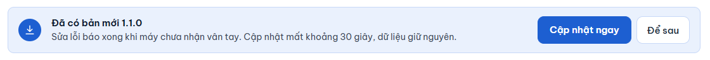
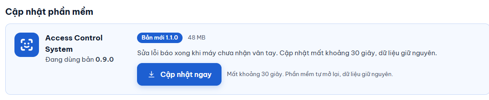

# Cập nhật phần mềm

**Ai làm:** Người quản lý phần mềm · **Mất khoảng:** 1 phút (cập nhật chạy khoảng 30 giây)

## Phần mềm tự tìm bản mới

Phần mềm kiểm tra bản mới trên GitHub 1 phút sau khi mở, rồi cứ 20 giờ kiểm tra một lần. Việc kiểm tra chạy nền, nếu lỗi mạng thì im lặng bỏ qua và lần sau thử lại.

Có bản mới, trên tab **Người dùng** hiện một thanh ghi **Đã có bản mới** kèm số phiên bản và ghi chú thay đổi.

<figure><figcaption></figcaption></figure>

Thanh có hai nút:

- **Cập nhật ngay**: mở tab **Máy chấm công & cập nhật**, nơi bạn bắt đầu cập nhật (xem bên dưới).
- **Để sau**: ẩn thanh cho tới khi bạn mở lại phần mềm hoặc có bản mới hơn.


Chỉ tab **Người dùng** hiện thanh này. Bạn luôn có thể vào mục **Cập nhật phần mềm** trên tab **Máy chấm công & cập nhật** để cập nhật, kể cả khi đã bấm **Để sau**.


## Cập nhật


**Trước khi bắt đầu:** nên đặt mật khẩu sao lưu để phần mềm tự sao lưu dữ liệu trước khi cài (xem [Sao lưu và khôi phục](sao-luu-khoi-phuc.md)). Chọn lúc không có ai đang đăng ký người, vì phần mềm sẽ tự đóng và mở lại.




### Mở mục Cập nhật phần mềm

Mở tab **Máy chấm công & cập nhật**. Mục **Cập nhật phần mềm** nằm đầu trang, ghi "Đang dùng bản" kèm số phiên bản hiện tại.

<figure><figcaption></figcaption></figure>



### Bấm Cập nhật ngay

Khi có bản mới, mục này hiện nhãn **Bản mới** kèm số phiên bản, dung lượng và ghi chú. Bấm **Cập nhật ngay**.

Phần mềm hiện **Đang tải bản mới…** kèm phần trăm. Trong lúc tải, bạn vẫn dùng phần mềm bình thường.



### Đợi phần mềm tự cài

Khi tải xong, phần mềm hiện **Đang cài bản …**. Phần mềm tự đóng rồi mở lại trong giây lát; bạn không phải làm gì thêm.



Phía sau, phần mềm làm lần lượt:

1. Tải bộ cài và kiểm tra kích thước cùng mã SHA-256. Nếu tải thiếu hoặc không khớp, nó bỏ file đó và báo lỗi, không cài.
2. Nếu đã đặt mật khẩu sao lưu, tự sao lưu một bản trước khi cài. Nếu chưa đặt, bỏ qua bước này và ghi một dòng vào [nhật ký](xem-nhat-ky.md).
3. Cài im lặng rồi mở lại phần mềm.

Dữ liệu được giữ nguyên vì nằm tách khỏi thư mục cài đặt. Các lần cập nhật sau không hiện lại cảnh báo "Windows đã bảo vệ máy tính" của lần cài đầu.


**Kết quả:** phần mềm mở lại, dòng "Đang dùng bản" ghi số phiên bản mới và mục này hiện **Bạn đang dùng bản mới nhất.**


## Kiểm tra bản mới bằng tay

Ở mục **Cập nhật phần mềm**, bấm **Kiểm tra bản mới**. Nút hiện **Đang kiểm tra…** rồi báo **Bạn đang dùng bản mới nhất.** hoặc hiện bản mới. Trước khi kiểm tra lần đầu, mục này ghi "Chưa biết có bản mới hay chưa."

## Tắt tự kiểm tra

Ở tab **Máy chấm công & cập nhật**, mục **Khác**, bỏ chọn ô **Tự kiểm tra bản mới mỗi ngày**. Phần mềm không tự tìm bản mới nữa; bạn vẫn dùng được **Kiểm tra bản mới** khi cần. Xem thêm [Tuỳ chọn](../tham-khao/tuy-chon.md).

## Lỗi thường gặp

Không kiểm tra được bản mới / Không tải được bản mới

Máy tính chưa có mạng hoặc không vào được GitHub. Kiểm tra mạng rồi bấm lại **Kiểm tra bản mới** hoặc **Cập nhật ngay**.

Bản mới tải về bị hỏng hoặc không đúng, phần mềm đã bỏ nó đi

File tải về không khớp mã SHA-256 nên phần mềm không cài. Bấm **Cập nhật ngay** để tải lại. Nếu lặp lại nhiều lần, báo cho người phát triển qua [trang Issues của dự án trên GitHub](https://github.com/tdphuong97/AccessControlSystem/issues).

Bản mới chưa có bộ cài cho máy này

Bản phát hành chưa kèm bộ cài cho Windows. Chờ bản sửa, bạn vẫn dùng bản hiện tại bình thường.

