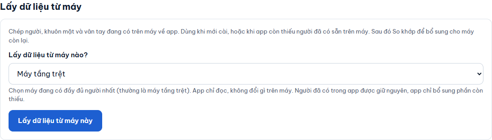

# Lấy dữ liệu từ máy

**Ai làm:** Người quản lý phần mềm · **Mất khoảng:** 1 phút cho 150 người

Dùng khi trên máy chấm công đã có sẵn người mà phần mềm chưa có. Ví dụ: mới cài phần mềm nhưng đã bỏ qua bước **Lấy dữ liệu** của [Thiết lập lần đầu](../bat-dau/thiet-lap-lan-dau.md), hoặc có người được thêm thẳng trên máy.

Phần mềm chỉ **đọc** máy, không thay đổi gì trên máy. Người đã có trong phần mềm được giữ nguyên. Phần mềm chỉ bổ sung người, khuôn mặt hoặc ngón tay còn thiếu.

Tên trên máy bắt đầu bằng mã công ty và dấu chấm (ví dụ `ABC. Lan`, `XYZ.KT.Minh`) thì người đó được xếp vào công ty `ABC`, `XYZ` trong phần mềm. Mã dài tối đa 6 chữ hoặc số. Tên không theo dạng này thì người đó chưa có nhóm; bạn chọn nhóm sau ở nút **Sửa**.


**Trước khi bắt đầu:** máy muốn lấy phải đang **Đã kết nối**. Máy mất kết nối hoặc đang báo sai mật khẩu không hiện trong ô chọn máy.




### Chọn máy

Mở tab **Máy chấm công & cập nhật**, đến mục **Lấy dữ liệu từ máy**. Trong ô **Lấy dữ liệu từ máy nào?**, chọn máy đang có đầy đủ người nhất, thường là máy tầng trệt.

<figure><figcaption></figcaption></figure>



### Lấy dữ liệu

Bấm **Lấy dữ liệu từ máy này**. Thanh tiến độ hiện **Đang lấy dữ liệu từ** tên máy, số người đã đọc trên tổng số, và tên người đang đọc.

Bạn có thể chuyển sang tab khác trong lúc chờ. Việc lấy vẫn chạy tiếp. Tab **Người dùng** hiện dòng "Đang lấy dữ liệu từ … Danh sách tự cập nhật khi xong." Quay lại mục này, bạn vẫn thấy thanh tiến độ.



### Đọc kết quả

Khi xong, mục này hiện **Đã lấy** số người, kèm số người có khuôn mặt và số vân tay. Có thể kèm cảnh báo vàng:

- Một số người "đã có mặt trên máy nhưng app chưa có ảnh": máy không cho tải ảnh gốc của họ. Họ vẫn vào được máy này; cần chụp lại một lần nếu muốn gửi sang máy kia.
- "Không đọc được đủ dữ liệu của N người": bấm **Mở Nhật ký** để xem người nào, rồi lấy lại sau.



### So khớp với máy còn lại

Bấm **Tiếp: So khớp 2 máy** và làm theo [So khớp 2 máy](so-khop-2-may.md). Dữ liệu vừa lấy mới chỉ có trong phần mềm và trên máy nguồn. So khớp mới đưa phần còn thiếu xuống máy kia.




**Kết quả:** tab **Người dùng** liệt kê những người vừa lấy về, và hiện thông báo nhắc chạy So khớp 2 máy. Sau khi So khớp xong, thông báo này biến mất.


## Lỗi thường gặp

Chưa có máy nào đang kết nối nên chưa lấy được dữ liệu

Không máy nào đang **Đã kết nối**. Xem thẻ máy ở mục **Máy chấm công** ngay phía trên: sửa mật khẩu nếu máy báo **Sai mật khẩu, đã dừng**, hoặc kiểm tra điện và mạng nếu máy báo **Mất kết nối**. Sau đó bấm **Đọc lại**.

Đang lấy thì mất mạng hoặc máy tắt

Mục này báo lỗi và nút đổi thành **Lấy lại dữ liệu**. Khi máy có mạng lại, bấm nút này. Phần mềm chạy tiếp, những người đã lấy không bị lấy trùng.

Lấy dữ liệu xong nhưng máy kia vẫn chưa có người đó

Đúng như vậy: lấy dữ liệu chỉ chép về phần mềm, không gửi xuống máy nào. Chạy [So khớp 2 máy](so-khop-2-may.md) rồi bấm **Bổ sung** để gửi sang máy còn lại.

