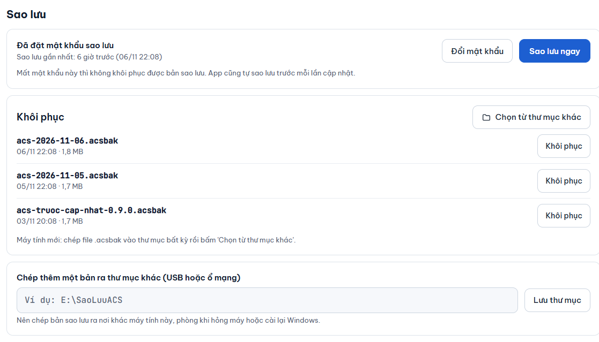

# Sao lưu và khôi phục

**Ai làm:** Người quản lý phần mềm · **Mất khoảng:** 5 phút

Bản sao lưu giữ toàn bộ người, khuôn mặt, vân tay và thiết lập máy của phần mềm, trong một file đuôi `.acsbak`. File được mã hoá bằng **mật khẩu sao lưu** do bạn đặt, nên chép ra USB hay ổ mạng cũng an toàn.

## Phần mềm tự sao lưu khi nào

- Khi mở phần mềm, nếu bản sao lưu gần nhất đã quá 24 giờ (hoặc chưa có bản nào). Phần mềm thường chạy nền suốt ngày nên thực tế là mỗi ngày một bản.
- Ngay trước mỗi lần [cập nhật phần mềm](cap-nhat-phan-mem.md).
- Khi bạn bấm **Sao lưu ngay**.

Phần mềm giữ 14 bản mới nhất trên máy tính và tự xoá bản cũ hơn. Tự sao lưu chỉ chạy khi đã đặt mật khẩu sao lưu.


Mất mật khẩu sao lưu thì không mở được bản sao lưu, và không ai lấy lại được, kể cả người phát triển phần mềm. Hãy ghi mật khẩu ở nơi an toàn, tách khỏi máy tính, ngay khi đặt.


## Đặt hoặc đổi mật khẩu sao lưu

Lần đầu dùng, bạn đặt mật khẩu này trong [Thiết lập lần đầu](../bat-dau/thiet-lap-lan-dau.md). Để đặt hoặc đổi sau này:



### Mở mục Sao lưu

Mở tab **Máy chấm công & cập nhật**, kéo xuống mục **Sao lưu**. Dòng đầu cho biết **Đã đặt mật khẩu sao lưu** hay **Chưa đặt mật khẩu sao lưu**.

<figure><figcaption></figcaption></figure>



### Nhập mật khẩu

Nếu đã có mật khẩu, bấm **Đổi mật khẩu**. Nhập vào ô **Mật khẩu (từ 8 ký tự)**, rồi nhập lại vào ô **Nhập lại mật khẩu**.



### Lưu

Bấm **Lưu mật khẩu**. Thông báo "Đã đặt mật khẩu sao lưu. Hãy ghi lại ở nơi an toàn." hiện ra.



## Sao lưu ngay

Bấm **Sao lưu ngay**. Thông báo "Đã sao lưu xong." hiện ra và bản mới nằm đầu danh sách. Nút này mờ khi chưa đặt mật khẩu sao lưu.

## Chép thêm một bản ra USB hoặc ổ mạng

Nên có một bản nằm ngoài máy tính, phòng khi máy hỏng hoặc cài lại Windows.

1. Ở ô **Chép thêm một bản ra thư mục khác (USB hoặc ổ mạng)**, nhập đường dẫn đầy đủ, ví dụ `E:\SaoLuuACS`.
2. Bấm **Lưu thư mục**. Thông báo "Đã lưu thư mục sao lưu thêm." hiện ra.

Từ đó mỗi lần sao lưu, phần mềm chép thêm một bản vào thư mục này. Bấm **Bỏ thư mục** để ngừng.


Nếu thư mục là USB, phải cắm USB mỗi khi phần mềm sao lưu. Kiểm tra định kỳ rằng bản mới thật sự có trong thư mục đó.


## Khôi phục

Khôi phục thay toàn bộ dữ liệu hiện tại bằng bản sao lưu. Mọi thay đổi sau thời điểm của bản đó sẽ mất.



1. Ở mục **Sao lưu**, tìm bản cần khôi phục trong danh sách (mỗi dòng ghi ngày giờ và dung lượng) rồi bấm **Khôi phục** ở dòng đó.
2. Hộp thoại **Khôi phục từ bản sao lưu?** hiện ra. Nhập mật khẩu đã đặt lúc tạo bản đó vào ô **Mật khẩu sao lưu**.
3. Bấm **Khôi phục**.



Dùng khi cài lại Windows hoặc chuyển sang máy tính khác. Cài phần mềm trước (xem [Cài đặt](../bat-dau/cai-dat.md)), sau đó:

1. Chép file `.acsbak` vào một thư mục bất kỳ trên máy mới, hoặc cắm USB có file đó.
2. Mở tab **Máy chấm công & cập nhật**, mục **Sao lưu**, bấm **Chọn từ thư mục khác**.
3. Nhập đường dẫn thư mục (ví dụ `E:\SaoLuuACS`) rồi bấm **Xem**. Danh sách file `.acsbak` trong thư mục hiện ra.
4. Chọn file cần khôi phục.
5. Nhập **Mật khẩu sao lưu** rồi bấm **Khôi phục**.

Bạn phải nhập đúng mật khẩu sao lưu. Khoá mã hoá trên máy cũ gắn với tài khoản Windows cũ nên không dùng lại được, còn bản sao lưu thì mở được trên máy mới chỉ bằng mật khẩu.



Phần mềm kiểm tra mật khẩu trước. Nếu sai, báo lỗi và dữ liệu hiện tại không bị đụng tới. Nếu đúng, hộp thoại hiện "Đã khôi phục. App đang tự khởi động lại…" và phần mềm tự mở lại.

## Sau khi khôi phục

Bản sao lưu có thể cũ hơn những gì máy chấm công đang giữ. Khi phần mềm mở lại, trên tab **Người dùng** hiện thông báo nhắc chạy So khớp 2 máy. Làm theo [So khớp 2 máy](so-khop-2-may.md) để đối chiếu và gửi lại phần thiếu.


**Kết quả:** danh sách người trở về đúng như lúc sao lưu, và sau So khớp, hai máy khớp với danh sách đó.


Dữ liệu nằm trong `%LOCALAPPDATA%\AccessControlSystem`, tách khỏi thư mục cài đặt. Cập nhật hoặc gỡ cài đặt phần mềm không làm mất dữ liệu.

## Lỗi thường gặp

Mật khẩu sao lưu chưa đúng

Nhập lại cẩn thận, chú ý chữ hoa và chữ thường. Dùng đúng mật khẩu đã đặt lúc bản đó được tạo. Nếu đã quên mật khẩu, không có cách mở bản sao lưu đó.

Mật khẩu sao lưu cần ít nhất 8 ký tự / Hai lần nhập chưa giống nhau

Nhập mật khẩu dài từ 8 ký tự trở lên, và gõ lại đúng như lần đầu ở ô **Nhập lại mật khẩu**.

Không có file sao lưu trong thư mục này

Phần mềm chỉ nhận file có tên dạng `ACS-….acsbak`. Kiểm tra đường dẫn, USB hoặc ổ mạng đã cắm chưa, rồi bấm **Xem** lại. Đường dẫn phải đầy đủ, có ổ đĩa, ví dụ `E:\SaoLuuACS`.

