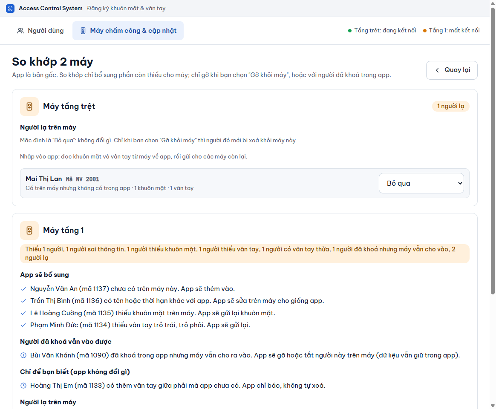

# So khớp 2 máy

**Ai làm:** Người quản lý phần mềm · **Mất khoảng:** 2 đến 5 phút

## Khi nào cần So khớp 2 máy

Chạy So khớp 2 máy khi:

- máy bị reset, hoặc bạn thay máy mới;
- bạn vừa thêm máy, đổi địa chỉ máy hoặc khôi phục từ bản sao lưu (trên tab **Người dùng** có thông báo nhắc);
- nghi hai máy lệch nhau, hoặc có người thêm, sửa thẳng trên máy hay bằng công cụ khác.

Phần mềm coi bản gốc của nó là chuẩn. So khớp đọc từng máy, so với bản gốc rồi nói bằng lời những gì lệch. Bạn xem trước, chưa có gì thay đổi cho tới khi bạn bấm **Bổ sung**.


**Phần mềm chưa có ai trong danh sách?** Khi đó mọi người trên máy đều hiện là người lạ. So khớp sẽ tự đề nghị **Lấy dữ liệu từ máy** trước: chọn máy có đủ người nhất, bấm **Lấy dữ liệu từ máy này**, chờ xong rồi bấm **Tiếp: So khớp 2 máy**. Sau đó So khớp chỉ hiện những người khác nhau giữa hai máy. Mục **Lấy dữ liệu từ máy** cũng có sẵn trên tab **Máy chấm công & cập nhật**.



**Trước khi bắt đầu:** cả hai máy phải bật và kết nối được. Nếu máy đang báo **sai mật khẩu**, sửa mật khẩu trước (xem [Thêm và sửa máy chấm công](them-sua-may.md)).




### Mở So khớp 2 máy

Mở tab **Máy chấm công & cập nhật**, đến mục **So khớp 2 máy** rồi bấm **So khớp 2 máy**. Nếu trên tab **Người dùng** có thông báo nhắc, bấm **Mở So khớp 2 máy** ở đó cũng được.

Màn hình **So khớp 2 máy** hiện **Đang đọc máy…** và đọc lần lượt từng máy. Việc này mất vài chục giây.



### Đọc kết quả của từng máy

Mỗi máy có một khối, bên phải tên máy là một dòng tóm tắt, ví dụ "Thiếu 3 người, 2 người thiếu vân tay". Máy khớp hoàn toàn hiện **Đã khớp** và dòng "Máy này đã khớp với app, không cần làm gì."

Trong khối có thể có các nhóm sau.

| Nhóm | Ý nghĩa | Phần mềm sẽ làm gì |
| --- | --- | --- |
| **App sẽ bổ sung** | Người chưa có trên máy, sai tên hoặc thời hạn, thiếu khuôn mặt hoặc thiếu vân tay. Mỗi dòng nói rõ người nào, thiếu gì. | Gửi phần thiếu, hoặc sửa trên máy cho giống bản gốc. |
| **Người đã khoá vẫn vào được** | Người đã **Khoá ra vào** trong phần mềm nhưng máy vẫn cho ra vào. | Gỡ hoặc tắt người đó trên máy. Dữ liệu vẫn giữ trong phần mềm. |
| **Chỉ để bạn biết (app không đổi gì)** | Máy có thêm vân tay mà phần mềm chưa có. | Không làm gì. |
| **Người lạ trên máy** | Người có trên máy nhưng không có trong phần mềm. | Tuỳ lựa chọn của bạn, xem bước sau. |

<figure><figcaption></figcaption></figure>



### Chọn cách xử lý người lạ

Với mỗi người lạ, chọn một trong ba cách trong ô bên phải.

| Lựa chọn | Phần mềm làm gì |
| --- | --- |
| **Bỏ qua** (mặc định) | Không đổi gì. Người đó vẫn nằm trên máy. |
| **Nhập vào app** | Đọc khuôn mặt và vân tay từ máy về phần mềm, rồi gửi cho các máy còn lại. |
| **Gỡ khỏi máy** | Xoá người đó khỏi máy này. Vì phần mềm không có bản gốc của họ nên không khôi phục lại được. |

Nếu không chắc, giữ **Bỏ qua**. Bạn có thể quay lại So khớp sau.



### Bổ sung

Bấm **Bổ sung**. Nếu bạn chọn **Gỡ khỏi máy** cho ai đó, hoặc có người đã khoá sẽ bị gỡ, phần mềm hỏi lại **Gỡ người khỏi máy?**. Bấm **Gỡ khỏi máy** để đồng ý, hoặc **Quay lại** để xem lại.

Màn hình hiện **Đang bổ sung…**, rồi **Đã bổ sung xong**.



Nút **Bổ sung** mờ khi không có gì để làm (mọi máy đã khớp và mọi người lạ đang để **Bỏ qua**). Bấm **Đọc lại** để đọc máy lần nữa.

## Bổ sung xong thì chuyện gì xảy ra

Bổ sung không gửi tức thì. Phần mềm tạo việc gửi cho từng máy và đưa vào hàng đợi; từng việc được gửi và đọc lại để kiểm tra như bình thường (xem [Theo dõi việc gửi xuống máy](theo-doi-gui-xuong-may.md)). Máy nào đang mất kết nối sẽ tự nhận khi có mạng lại.

Thông báo nhắc trên tab **Người dùng** biến mất sau khi So khớp xong. Bấm **Về danh sách người dùng** để quay lại.


**Kết quả:** các máy khớp với bản gốc. Cột cuối của danh sách người dần chuyển sang **Đủ 2 máy** khi việc gửi chạy xong.


## Phần mềm có tự xoá gì không

Không. Phần mềm chỉ bổ sung phần thiếu. Có hai trường hợp gỡ khỏi máy, và cả hai đều hỏi xác nhận trước:

- người lạ mà bạn tự chọn **Gỡ khỏi máy**;
- người đã khoá trong phần mềm mà máy vẫn cho ra vào.

Với người đã khoá, nếu máy đang giữ khuôn mặt hoặc vân tay mà phần mềm chưa có bản, phần mềm chỉ tắt người đó trên máy chứ không gỡ, để không mất bản sinh trắc duy nhất.

## Khi một máy đang offline

So khớp cần đọc được cả hai máy. Nếu một máy tắt hoặc mất mạng, màn hình báo lỗi dạng "Không đọc được Máy tầng 1: … Kiểm tra máy có điện/mạng rồi so khớp lại." và chưa thay đổi gì. Bật máy lại rồi bấm **Đọc lại**.

Nếu máy đang dừng vì sai mật khẩu, màn hình báo không đọc được và nhắc vào nút **Sửa mật khẩu**. Sửa mật khẩu xong rồi chạy lại.

Máy mất kết nối **sau khi** bạn bấm **Bổ sung** thì không sao: việc gửi nằm trong hàng đợi và tự chạy khi máy có mạng lại.

## Lỗi thường gặp

Nút Bổ sung bị mờ

Không có gì cần làm: các máy đã khớp và mọi người lạ đang để **Bỏ qua**. Chọn **Nhập vào app** hoặc **Gỡ khỏi máy** cho một người lạ nếu bạn muốn xử lý họ.

Màn hình báo "Không đọc được …"

Máy được nêu tên đang tắt, mất mạng hoặc sai mật khẩu. Xem mục [Khi một máy đang offline](#khi-mot-may-dang-offline) và [Xử lý sự cố](../tham-khao/xu-ly-su-co.md).

