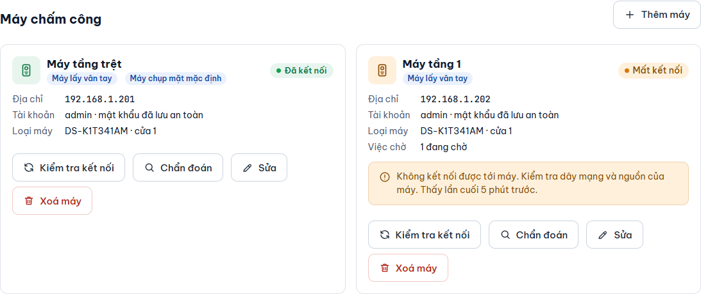
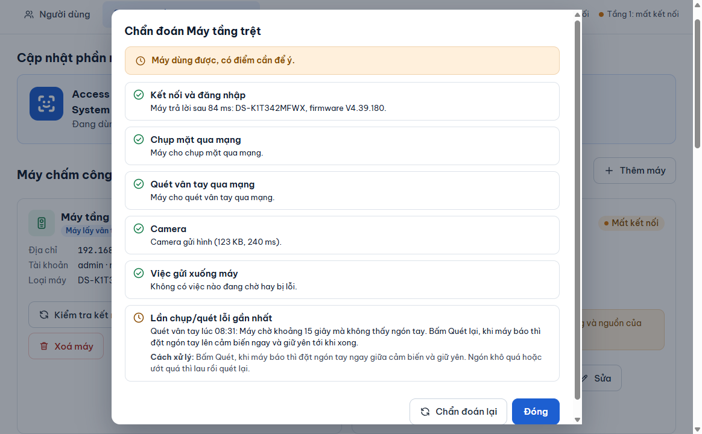

# Thêm và sửa máy chấm công

**Ai làm:** Người quản lý phần mềm · **Mất khoảng:** 3 phút

Mọi thao tác về máy nằm ở tab **Máy chấm công & cập nhật**, mục **Máy chấm công**. Mỗi máy là một thẻ cho biết **Địa chỉ**, **Tài khoản**, **Loại máy**, trạng thái kết nối và các vai trò (**Máy lấy vân tay**, **Máy chụp mặt mặc định**).

<figure><figcaption></figcaption></figure>

## Thêm máy


**Trước khi bắt đầu:** chuẩn bị tên gọi cho máy, địa chỉ IP của máy (ví dụ `192.168.1.201`), tài khoản và mật khẩu đăng nhập máy. Máy tính và máy chấm công phải cùng mạng. Lần đầu dùng phần mềm, bạn làm bước này trong [Thiết lập lần đầu](../bat-dau/thiet-lap-lan-dau.md).




### Mở biểu mẫu

Ở mục **Máy chấm công**, bấm **Thêm máy**. Biểu mẫu **Thêm máy chấm công** hiện ra ngay phía trên danh sách máy.



### Điền thông tin

Ô có dấu \* là bắt buộc.

| Ô | Điền gì |
| --- | --- |
| **Tên máy** \* | Tên dễ nhớ, ví dụ `Máy tầng trệt`. |
| **Địa chỉ máy** \* | Số IP hoặc tên máy, ví dụ `192.168.1.201`. Không gõ `http://` và không có dấu cách. |
| **Tài khoản** \* | Tài khoản đăng nhập máy, thường là `admin`. |
| **Mật khẩu** \* | Mật khẩu của máy. Phần mềm mã hoá và lưu trên máy tính này, không hiện lại. |
| **Số cửa** | Số cửa mà máy điều khiển, từ 1 đến 8. Mặc định là 1. |
| **Dùng máy này để chụp mặt (máy chụp mặc định)** | Chọn nếu bạn chụp khuôn mặt bằng camera của máy này. Chỉ một máy được là máy chụp mặc định; chọn máy này thì máy kia tự bỏ. Mặc định: không chọn. |
| **Dùng máy này để quét vân tay** | Chọn nếu bạn đặt ngón tay lên máy này để lấy vân tay. Mặc định: chọn. |



### Lưu máy

Bấm **Lưu máy**. Thông báo "Đã lưu … Bấm "Kiểm tra kết nối" để thử máy." hiện ra và thẻ máy xuất hiện trong danh sách.



### Kiểm tra kết nối

Trên thẻ máy vừa thêm, bấm **Kiểm tra kết nối**. Phần mềm hiện **Đang kiểm tra kết nối…**, rồi báo kết quả, ví dụ:

Kết nối tốt · tên model · bản phần mềm của máy · 120 người trên máy. Chụp mặt qua mạng: được · Quét vân tay qua mạng: được

Nếu hiện **chưa được** ở mục chụp mặt hoặc quét vân tay, máy đó không nhận lệnh qua mạng; xem [Những trường hợp không làm được](../tham-khao/gioi-han.md).



### So khớp máy mới

Máy mới chưa có việc nào trong hàng đợi. Chạy [So khớp 2 máy](so-khop-2-may.md) để phần mềm đọc máy và gửi những gì còn thiếu.




**Kết quả:** thẻ máy hiện **Đã kết nối** và chấm trạng thái của máy trên đầu cửa sổ chuyển xanh.


## Sửa máy

Trên thẻ máy, bấm **Sửa**. Biểu mẫu **Sửa** kèm tên máy mở ra với các ô như trên. Sửa xong bấm **Lưu máy**; bấm **Huỷ** để bỏ.



Dùng khi máy báo **Sai mật khẩu, đã dừng** hoặc khi bạn đã đổi mật khẩu trên máy.

1. Trên thẻ máy, bấm **Sửa mật khẩu** (nút **Sửa** đổi tên khi máy đang dừng vì sai mật khẩu).
2. Nhập mật khẩu mới vào ô **Mật khẩu**. Để trống ô này nghĩa là giữ mật khẩu đã lưu.
3. Bấm **Lưu máy**.

Phần mềm mở lại việc gửi tới máy đó và các việc chờ chạy tiếp. Sau đó bấm **Kiểm tra kết nối** để chắc chắn.



Dùng khi máy đổi địa chỉ IP hoặc bạn thay máy khác vào chỗ cũ.

1. Trên thẻ máy, bấm **Sửa**.
2. Nhập địa chỉ mới vào ô **Địa chỉ máy**.
3. Bấm **Lưu máy**.

Vì địa chỉ mới có thể là một máy khác (máy thay hoặc máy vừa reset), phần mềm **quên** những gì máy cũ đã xác nhận: các dấu **Đủ** của máy này không còn được tin. Trên tab **Người dùng** hiện thông báo nhắc chạy [So khớp 2 máy](so-khop-2-may.md) để đọc máy mới và gửi phần thiếu.



Tên máy, **Số cửa** và hai ô vai trò đổi tự do, không cần So khớp lại. Bấm **Lưu máy** là xong.



## Chẩn đoán máy

Khi một máy chụp, quét hoặc gửi bị lỗi mà chưa rõ vì sao, bấm **Chẩn đoán** trên thẻ máy, hoặc **Chẩn đoán máy** ngay trong thông báo lỗi lúc chụp mặt, quét vân tay. Phần mềm kiểm tra lần lượt và đánh dấu từng mục đạt (xanh), cần để ý (vàng) hoặc lỗi (đỏ), kèm **Cách xử lý**:

| Mục | Phần mềm kiểm tra |
| --- | --- |
| **Kết nối và đăng nhập** | Máy có trả lời không, nhanh hay chậm, mật khẩu có đúng không. Lỗi ở đây thì dừng, các mục sau phụ thuộc vào nó. |
| **Chụp mặt qua mạng**, **Quét vân tay qua mạng** | Máy có nhận lệnh chụp, quét từ phần mềm không. |
| **Camera** | Máy có gửi hình camera không (dùng cho hình trực tiếp). |
| **Việc gửi xuống máy** | Còn việc đang chờ hay bị lỗi không. |
| **Lần chụp/quét lỗi gần nhất** | Lỗi chụp mặt, quét vân tay trong 24 giờ qua, kèm câu trả lời của máy. |

<figure><figcaption></figcaption></figure>

Bấm **Chẩn đoán lại** sau khi đã xử lý. Chẩn đoán không đổi gì trên máy. Máy đang dừng vì sai mật khẩu thì phần mềm không đăng nhập thử lại, chỉ nhắc sửa mật khẩu.

## Xoá máy

1. Trên thẻ máy, bấm **Xoá máy**.
2. Hộp thoại **Xoá … khỏi app?** hiện ra. Bấm **Xoá máy** để đồng ý, hoặc **Giữ lại**.

Phần mềm ngừng gửi dữ liệu tới máy đó. Người, khuôn mặt và vân tay trong phần mềm vẫn giữ nguyên, và dữ liệu đang có trên máy chấm công không bị xoá.

## Lỗi thường gặp

Hãy nhập địa chỉ của máy / Địa chỉ máy chỉ gồm số IP hoặc tên máy

Ô **Địa chỉ máy** để trống, hoặc có `http://` hay dấu cách. Chỉ nhập số IP, ví dụ `192.168.1.201`.

Sai mật khẩu hoặc máy đang khoá tạm (khoảng 30 phút)

Máy từ chối đăng nhập và phần mềm đã dừng, không thử lại để tránh bị khoá lâu hơn. Nhập đúng mật khẩu ở **Sửa mật khẩu**. Nếu mật khẩu chắc chắn đúng mà vẫn lỗi, đợi khoảng 30 phút cho máy mở khoá rồi bấm **Kiểm tra kết nối**.

Kiểm tra kết nối báo không kết nối được

Kiểm tra nguồn và dây mạng của máy, địa chỉ IP, và máy tính có cùng mạng với máy chấm công không. Xem [Xử lý sự cố](../tham-khao/xu-ly-su-co.md).

