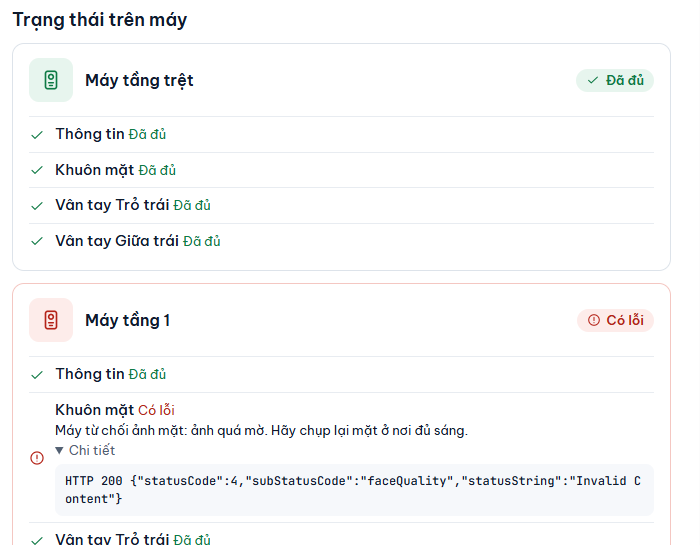

# Theo dõi việc gửi xuống máy

**Ai làm:** Người quản lý phần mềm · **Khi nào:** khi thêm, sửa người rồi muốn biết dữ liệu đã tới máy chưa, hoặc khi thấy máy báo lỗi

## Bạn cần bấm gì để đồng bộ

Không có nút "đồng bộ". Sau mỗi thao tác, phần mềm tự gửi xuống mọi máy. Chỉ khi phần mềm chưa biết trên máy có gì, bạn mới cần chạy So khớp.

| Bạn vừa làm | Phần mềm tự làm | Bạn cần bấm |
| --- | --- | --- |
| Thêm người mới, chụp khuôn mặt, lấy vân tay | Gửi người đó xuống cả hai máy ngay khi có khuôn mặt hoặc vân tay đầu tiên. Chưa có cả hai thì không lưu, không gửi | Không cần |
| Sửa thông tin, **Khoá ra vào**, mở lại, xoá hẳn, khôi phục từ Thùng rác | Gửi thay đổi xuống cả hai máy | Không cần |
| Máy mất mạng rồi có mạng lại | Gửi tiếp các việc đang chờ | Không cần. Muốn gửi ngay: **Thử lại** trên thẻ máy |
| [Lấy dữ liệu từ máy](lay-du-lieu-tu-may.md) | Chỉ chép về phần mềm, chưa gửi sang máy kia | **So khớp 2 máy**, rồi **Bổ sung** |
| Thêm máy, đổi địa chỉ máy, khôi phục bản sao lưu, hoặc có người thêm thẳng trên máy | Chưa gửi gì, hiện thông báo nhắc So khớp | **So khớp 2 máy**, rồi **Bổ sung** |

## Phần mềm gửi xuống máy như thế nào

Khi bạn thêm hoặc sửa một người, phần mềm lưu vào bản gốc trước, rồi xếp việc gửi vào **hàng đợi** của từng máy. Mỗi máy có một hàng đợi riêng, làm lần lượt từng việc.

Với mỗi việc, phần mềm gửi xuống máy rồi đọc lại từ máy để kiểm tra. Chỉ khi đọc lại thấy đúng, việc đó mới được tính là xong. Vì vậy dấu **Đủ** luôn là dữ liệu đã nằm thật trên máy.

Bạn không cần bấm gì thêm trong các trường hợp sau.

| Tình huống | Phần mềm làm gì |
| --- | --- |
| Máy bận hoặc trả lời lỗi tạm thời | Tự gửi lại, giãn dần: 30 giây, 1 phút, 2 phút, 5 phút, 10 phút, rồi cứ 15 phút một lần cho tới khi được. |
| Máy tắt hoặc mất mạng | Việc nằm chờ trong hàng đợi, không mất. Phần mềm kiểm tra máy mỗi 30 giây; khi máy có mạng lại, các việc chờ được gửi ngay. |
| Tắt phần mềm hoặc tắt máy tính | Việc chờ vẫn còn và gửi tiếp khi mở lại phần mềm. |
| Máy từ chối hẳn (ví dụ ảnh mặt quá mờ) | Dừng việc đó và báo lỗi kèm lý do. Việc này cần bạn xử lý, phần mềm không tự thử lại. |
| Sai mật khẩu máy | Dừng ngay sau lần sai đầu tiên, không tự thử lại. Xem mục bên dưới. |


Phần mềm chỉ gửi khi đang chạy. Nên bật **Tự chạy cùng Windows** (xem [Tuỳ chọn](../tham-khao/tuy-chon.md)) để việc chờ không bị bỏ lỡ khi máy tính vừa bật.


## Đọc các chấm trạng thái trên đầu cửa sổ

Bên phải hàng thẻ **Người dùng** và **Máy chấm công & cập nhật** có một chấm cho mỗi máy, ví dụ **Tầng trệt: đã kết nối**. Phần mềm bỏ chữ "Máy" ở đầu tên cho gọn.

| Chấm | Chữ | Ý nghĩa |
| --- | --- | --- |
| Xanh | **đã kết nối** | Máy trả lời bình thường, việc gửi chạy được. |
| Vàng | **mất kết nối** | Phần mềm không gọi được máy (tắt nguồn, đứt mạng, sai địa chỉ). Việc chờ sẽ tự gửi khi máy có lại. |
| Đỏ | **sai mật khẩu** | Máy từ chối tài khoản hoặc mật khẩu. Phần mềm đã dừng gửi tới máy này. |

Trên tab **Người dùng**, mỗi máy còn có một thẻ chi tiết hơn:

- **Đã kết nối**: thẻ hiện số người và vai trò của máy.
- **Mất kết nối**: thẻ cho biết đã mất bao lâu và có bao nhiêu việc chờ, ví dụ "Có 4 việc đang chờ. App sẽ tự gửi khi máy có mạng lại." Bấm **Thử lại** để phần mềm kiểm tra máy ngay, không phải đợi.
- **Sai mật khẩu, đã dừng**: bấm **Sửa mật khẩu** để mở tab **Máy chấm công & cập nhật**.

## Xem việc nào còn chờ

Có ba nơi để xem.



Mở tab **Máy chấm công & cập nhật**, mục **Máy chấm công**. Thẻ của mỗi máy có dòng **Việc chờ**, ví dụ "2 đang chờ · 1 lỗi". Dòng này chỉ hiện khi còn việc chờ hoặc việc lỗi.



Mở tab **Người dùng**. Cột cuối của mỗi người cho biết:

- **Đủ 2 máy**: đã tới cả hai máy.
- **Chờ gửi** kèm tên máy: còn việc đang chờ.
- **Lỗi gửi, mở để xem**: có việc bị lỗi.

Bấm **Chưa đủ 2 máy** ở hàng bộ lọc để chỉ xem những người chưa xong. Bấm **Mở** trên một người để xem từng phần (**Thông tin**, **Khuôn mặt**, từng ngón vân tay) đã **Đã đủ**, **Đang chờ gửi** hay **Có lỗi**.



Mở [Xem nhật ký](xem-nhat-ky.md) để xem từng lần gửi, kể cả những lần thành công.



<figure><figcaption></figcaption></figure>

## Gửi lại khi có lỗi

Trên màn hình một người, thẻ của máy nào chưa **Đã đủ** đều có nút **Thử lại ngay**. Bấm nút này, phần mềm đưa các việc lỗi về hàng đợi và gửi lại ngay. Nếu máy đó đang dừng vì sai mật khẩu, nút này cũng mở khoá cho phần mềm thử đăng nhập lại.


Chỉ bấm **Thử lại ngay** sau khi bạn đã kiểm tra mật khẩu của máy. Máy Hikvision có thể khoá địa chỉ của máy tính khoảng 30 phút nếu đăng nhập sai vài lần liên tiếp.


## Sau khi sai mật khẩu

Phần mềm dừng gửi tới máy đó để không đăng nhập sai nhiều lần. Các việc đang chờ vẫn được giữ.

1. Mở tab **Máy chấm công & cập nhật**.
2. Trên thẻ của máy báo **Sai mật khẩu, đã dừng**, bấm **Sửa mật khẩu**.
3. Nhập mật khẩu mới vào ô **Mật khẩu**, bấm **Lưu máy**.

Phần mềm mở lại việc gửi và các việc chờ chạy tiếp. Chi tiết ở [Thêm và sửa máy chấm công](them-sua-may.md).

## Khi máy mới hoặc vừa khôi phục chưa nhận dữ liệu

Phần mềm không tự xếp việc gửi cho một máy vừa thêm, vừa đổi địa chỉ, vừa lấy dữ liệu hoặc vừa khôi phục từ bản sao lưu, vì chưa biết trên máy đó có gì. Khi đó trên tab **Người dùng** hiện thông báo:

> Có máy mới, máy vừa đổi, vừa khôi phục hoặc vừa lấy dữ liệu — chạy So khớp 2 máy để gửi đủ cho mọi máy.

Trên màn hình từng người, phần chưa được xác nhận trên máy hiện dòng "Chưa có trên máy này — chạy So khớp 2 máy." Bấm **Mở So khớp 2 máy** và làm theo [So khớp 2 máy](so-khop-2-may.md).


**Kết quả:** các chấm đều **đã kết nối**, cột cuối của danh sách người hiện **Đủ 2 máy** và không còn dòng **Việc chờ** trên thẻ máy.


## Lỗi thường gặp

Máy báo mất kết nối mãi dù máy vẫn bật

Kiểm tra máy tính và máy chấm công có cùng mạng không, và địa chỉ máy còn đúng không (xem [Thêm và sửa máy chấm công](them-sua-may.md)). Bấm **Kiểm tra kết nối** trên thẻ máy để xem lý do cụ thể.

Việc chờ không giảm dù máy đã kết nối

Mở người đó, đọc thông báo dưới từng mục. Nếu có chữ **Có lỗi**, làm theo hướng dẫn trong thông báo rồi bấm **Thử lại ngay**. Xem thêm [Xử lý sự cố](../tham-khao/xu-ly-su-co.md).

