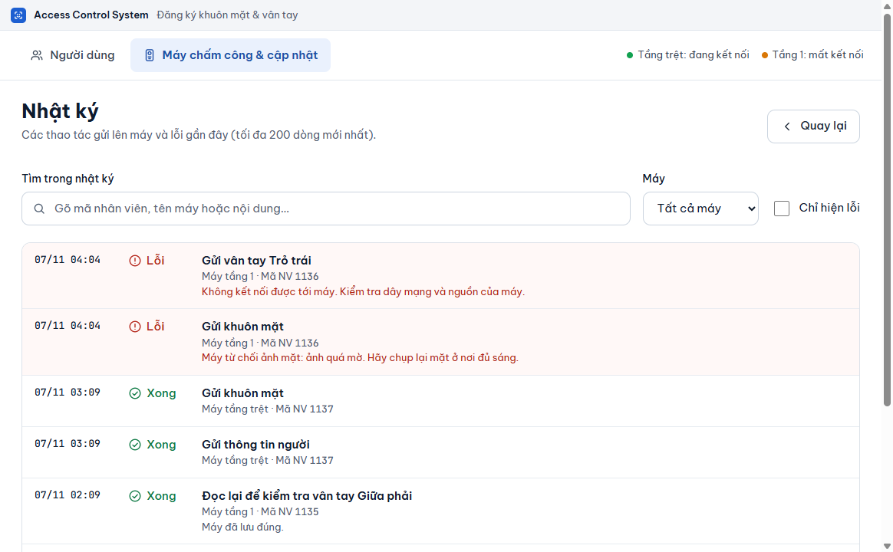

# Xem nhật ký

**Ai làm:** Người quản lý phần mềm · **Khi nào:** khi cần biết vì sao một người chưa tới máy, hoặc khi người hỗ trợ yêu cầu xem lỗi

## Mở Nhật ký

1. Mở tab **Máy chấm công & cập nhật**.
2. Kéo xuống mục **Khác** và bấm **Xem nhật ký thao tác**.

Màn hình **Nhật ký** hiện ra. Bấm **Quay lại** để về tab trước.

<figure><figcaption></figcaption></figure>

## Nhật ký ghi gì

Nhật ký liệt kê các thao tác gửi xuống máy và các lỗi gần đây, tối đa 200 dòng mới nhất, dòng mới ở trên cùng. Mỗi dòng có:

- thời gian (ngày/tháng giờ:phút);
- kết quả: **Xong** hoặc **Lỗi**;
- việc đã làm, tên máy (hoặc "Không gắn với máy nào") và mã nhân viên nếu liên quan;
- lời giải thích, nhất là khi lỗi.

Các việc có thể xuất hiện:

| Việc | Ý nghĩa |
| --- | --- |
| **Thông tin**, **Khuôn mặt**, **Vân tay** | Gửi thông tin người, ảnh mặt, vân tay xuống máy. |
| **Xoá khỏi máy**, **Xoá khuôn mặt**, **Xoá vân tay** | Gỡ dữ liệu khỏi máy, khi bạn khoá, xoá hoặc chọn **Gỡ khỏi máy** ở So khớp. |
| **Kiểm tra kết nối** | Phần mềm không gọi được máy. Chỉ ghi lần máy chuyển từ kết nối sang mất kết nối, không ghi lặp mỗi 30 giây. |
| **Đăng nhập máy** | Máy từ chối mật khẩu; phần mềm đã dừng gửi tới máy đó. |
| **Luồng gửi dữ liệu** | Lỗi không rõ ở khâu gửi của một máy. Phần mềm tự thử lại sau 30 giây. |
| **Sao lưu** | Lần sao lưu tự động bị lỗi. |
| **Cập nhật** | Ghi chú khi cập nhật mà chưa đặt mật khẩu sao lưu nên không sao lưu trước. |

## Lọc và tìm

Ba công cụ nằm phía trên danh sách. Dùng được cùng lúc.

| Công cụ | Cách dùng |
| --- | --- |
| **Tìm trong nhật ký** | Gõ mã nhân viên, tên máy hoặc một đoạn nội dung. Không cần gõ dấu tiếng Việt. |
| **Máy** | Chọn **Tất cả máy** hoặc một máy cụ thể. |
| **Chỉ hiện lỗi** | Chọn để ẩn các dòng **Xong**. |

Dòng dưới danh sách cho biết đang hiện bao nhiêu dòng, ví dụ "Đang hiện 3 dòng trên 40". Nếu không có dòng nào khớp, màn hình ghi "Không có dòng nào khớp. Thử bỏ bớt bộ lọc."


Bộ lọc **Máy** lấy lại tối đa 200 dòng của riêng máy đó. Các dòng cũ hơn 200 dòng gần nhất sẽ không hiện, kể cả khi lọc.


## Lỗi thường gặp

Nhật ký còn trống

Phần mềm chưa gửi gì xuống máy. Khi bạn thêm hoặc sửa người, các thao tác sẽ hiện ở đây.

Không thấy dòng nói về một người cụ thể

Gõ mã nhân viên vào **Tìm trong nhật ký**. Nếu người đó được gửi từ lâu, dòng của họ có thể đã nằm ngoài 200 dòng gần nhất. Mở trang của người đó ở tab **Người dùng** để xem trạng thái hiện tại, xem [Tìm và xem một người](../nguoi-dung/tim-va-xem.md).

