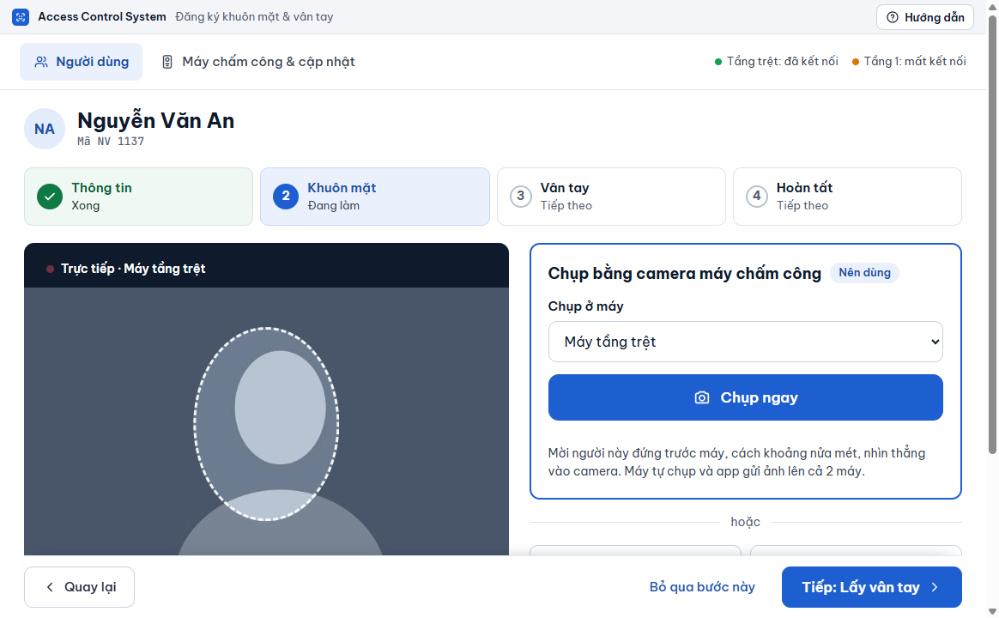

# Chụp khuôn mặt

**Ai làm:** người phụ trách đăng ký nhân viên · **Mất khoảng:** 10 giây nếu chụp bằng camera máy chấm công

Đây là bước **Khuôn mặt** (bước 2) của [Thêm người mới](them-nguoi-moi.md). Bạn cũng vào được từ màn hình của một người, bằng nút **Chụp lại mặt**.


**Trước khi bắt đầu:** mời người đó đứng trước máy, cách khoảng nửa mét, nhìn thẳng vào camera. Phần mềm gợi ý ba điều: đủ sáng và không đứng ngược sáng; bỏ khẩu trang, kính râm, mũ; nhìn thẳng, không nghiêng đầu.


Màn hình có ba cách lấy ảnh. Chọn cách phù hợp.



Cách này có nhãn **Nên dùng**. Ảnh chụp ngay tại máy chấm công nên khớp nhất với cách máy nhận diện sau này.

1. Trong ô **Chụp ở máy**, chọn máy sẽ chụp. Máy dùng để chụp mặt đã được chọn sẵn. Máy mất kết nối hoặc sai mật khẩu vẫn nằm trong danh sách, có ghi chú kèm theo tên.
2. Khung bên trái hiện hình camera của máy đó, có nhãn **Trực tiếp** và tên máy, hình tự cập nhật vài lần mỗi giây. Giữa khung có một **vòng canh mặt** nét đứt: canh cho mặt người đó nằm gọn trong vòng và đủ sáng.
3. Bấm **Chụp ngay**. Màn hình hiện **Đang chụp…** và dòng mời người đó nhìn thẳng vào camera của máy đã chọn.
4. Trong lúc máy chụp, khung bên trái vẫn hiện hình trực tiếp: nhãn đổi thành **Đang chụp**, vòng canh mặt chuyển sang màu xanh, kèm dòng mời nhìn thẳng vào camera.
5. Máy tự chụp. Ảnh hiện ở khung bên trái kèm nhãn **Đã chụp · ảnh rõ nét**, bên dưới là trạng thái từng máy.

Chụp chưa đẹp thì bấm **Chụp lại**. Ảnh mới thay ảnh cũ.

Khung báo **Chưa xem được hình trực tiếp** khi máy mất kết nối hoặc không gửi hình. Bạn vẫn bấm **Chụp ngay** được; phần mềm tự thử xem lại sau vài giây.

Chụp bị lỗi thì dưới nút có thông báo lỗi kèm nút **Chẩn đoán máy**: bấm vào để phần mềm kiểm tra máy và nói cách xử lý (xem [Chẩn đoán máy](../may-cham-cong/them-sua-may.md#chan-doan-may)). Mỗi lần chụp lỗi cũng được ghi vào **Nhật ký**.

<figure><figcaption></figcaption></figure>



Dùng khi máy chấm công cũ không hỗ trợ chụp qua mạng, hoặc người đó không đứng ở máy được.

1. Bấm **Webcam máy tính**. Windows có thể hỏi quyền dùng camera, hãy cho phép.
2. Hộp **Chụp bằng webcam** hiện hình từ webcam. Mời người đó nhìn thẳng vào webcam.
3. Bấm **Chụp**. Phần mềm xử lý ảnh rồi gửi xuống cả hai máy.

Bấm **Thôi** để đóng hộp mà không chụp.



Dùng khi bạn đã có ảnh chân dung rõ mặt trên máy tính.

1. Bấm **Chọn ảnh có sẵn**.
2. Chọn một tệp ảnh (JPG hoặc PNG). Phần mềm xử lý ảnh rồi gửi xuống cả hai máy.



Với webcam và ảnh có sẵn, phần mềm tự thu nhỏ ảnh (cạnh dài nhất tối đa 640 điểm ảnh) và nén xuống tối đa 200 KB, theo yêu cầu của máy. Bạn không cần chỉnh ảnh trước.


**Kết quả:** ảnh hiện ở khung bên trái, mỗi máy một dòng: **Đã nhận**, hoặc **Chờ — tự gửi khi máy có mạng**, hoặc **Có lỗi** kèm lý do. Bấm **Tiếp: Lấy vân tay** để sang bước sau. Nếu chưa muốn chụp, bấm **Bỏ qua bước này** (nút này mất đi khi đã có ảnh).


## Lỗi thường gặp

Lỗi hiện ngay dưới nút chụp, ảnh cũ (nếu có) vẫn giữ nguyên.

Máy chưa chụp được. Mời đứng thẳng trước camera rồi bấm lại.

Máy không thấy mặt. Mời người đó đứng thẳng, đủ sáng, rồi bấm **Chụp ngay** lại.

Máy này không hỗ trợ chụp khuôn mặt. Kiểm tra model máy hoặc cập nhật firmware.

Máy cũ không nhận lệnh chụp qua mạng. Dùng cách **Webcam máy tính** hoặc **Chọn ảnh có sẵn**. Xem thêm [Những trường hợp không làm được](../tham-khao/gioi-han.md).

Không mở được webcam. Hãy cho phép app dùng camera, hoặc chọn ảnh có sẵn.

Windows chặn quyền camera cho phần mềm. Mở **Cài đặt** của Windows, vào phần quyền riêng tư của camera, cho phép ứng dụng dùng camera, rồi thử lại. Hoặc dùng **Chọn ảnh có sẵn**.

Máy tính này không có webcam dùng được. Hãy chụp bằng camera máy chấm công hoặc chọn ảnh có sẵn.

Máy tính không có webcam. Chụp bằng camera máy chấm công hoặc chọn ảnh có sẵn.

Không đọc được ảnh này. Hãy chọn ảnh JPG hoặc PNG khác.

Tệp không phải ảnh, hoặc bị hỏng. Chọn tệp ảnh JPG hoặc PNG khác.

Ảnh quá lớn, hãy chọn ảnh khác

Dù đã nén, ảnh vẫn vượt 200 KB. Chọn ảnh có độ phân giải thấp hơn, hoặc chụp bằng webcam.

Ảnh khuôn mặt chưa đạt chất lượng. Chụp lại ảnh rõ mặt, đủ sáng, nhìn thẳng.

Máy chấm công từ chối ảnh vì mờ, ngược sáng, mặt nhỏ hoặc nghiêng. Thông báo này hiện ở dòng của máy, bấm **Chi tiết** để xem thêm. Chụp lại theo ba gợi ý ở đầu trang.

Máy không nhận ra khuôn mặt trong ảnh. Chụp lại ảnh rõ mặt, đủ sáng, nhìn thẳng.

Ảnh không có mặt đủ rõ để máy nhận. Chụp ảnh chân dung, mặt chiếm phần lớn khung hình.

Thư viện khuôn mặt trên máy đã đầy. Xoá bớt khuôn mặt không còn dùng rồi thử lại.

Máy hết chỗ lưu mặt. Xoá bớt người không còn dùng (xem [Xoá hẳn một người](xoa-han.md)), rồi bấm **Thử lại ngay**.

Một máy chỉ hiện "Chờ — tự gửi khi máy có mạng"

Máy đó đang mất kết nối. Ảnh đã được lưu trong phần mềm và sẽ tự gửi khi máy có mạng lại. Xem [Theo dõi việc gửi xuống máy](../may-cham-cong/theo-doi-gui-xuong-may.md).

