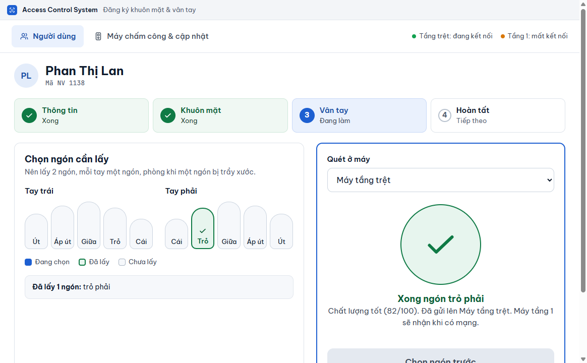

# Lấy vân tay

**Ai làm:** người phụ trách đăng ký nhân viên · **Mất khoảng:** 30 giây cho mỗi ngón

Đây là bước **Vân tay** (bước 3) của [Thêm người mới](them-nguoi-moi.md). Bạn cũng vào được từ màn hình của một người, bằng nút **Thêm vân tay**.


**Trước khi bắt đầu:** người đó đứng sẵn ở máy có đầu đọc vân tay, ngón tay sạch và khô. Nên lấy 2 ngón, mỗi tay một ngón, phòng khi một ngón bị trầy xước.




### Chọn máy quét

Trong ô **Quét ở máy**, chọn máy có đầu đọc vân tay. Máy dùng để quét đã được chọn sẵn.



### Chọn ngón

Trên hình hai bàn tay (**Tay trái** và **Tay phải**), bấm vào ngón cần lấy: **Cái**, **Trỏ**, **Giữa**, **Áp út** hoặc **Út**. Ngón đang chọn có màu nhấn, ngón đã lấy có dấu tích xanh và không bấm lại được. Dòng **Đã lấy** bên dưới liệt kê các ngón đã có.

Dòng trạng thái đổi thành **Sẵn sàng lấy ngón** kèm tên ngón.

<figure><figcaption></figcaption></figure>



### Quét

Bấm **Bắt đầu quét**. Màn hình hiện **Mời đặt ngón** kèm tên ngón **lên đầu đọc**. Mời người đó đặt đúng ngón đó lên đầu đọc của máy đã chọn và giữ yên đến khi máy kêu bíp.

Nút đổi thành **Đang chờ ngón tay…** trong lúc chờ.



### Đọc kết quả

Khi quét xong, vòng tròn chuyển xanh và dòng **Xong ngón** kèm tên ngón hiện ra, kèm chất lượng và trạng thái gửi xuống từng máy. Lặp lại từ bước chọn ngón cho ngón thứ hai, rồi bấm **Tiếp: Hoàn tất**.



## Chất lượng vân tay

Phần mềm báo chất lượng theo thang 100 ngay sau khi quét.

| Hiện ra | Nghĩa là gì |
| --- | --- |
| **Chất lượng tốt** (từ 70 trở lên) | Dùng tốt. |
| **Chất lượng đạt** (từ 40 đến dưới 70) | Dùng được. Nếu máy hay không nhận ngón này, quét lại. |
| Dưới 40 | Phần mềm không lưu, hiện thông báo chất lượng thấp. Quét lại. |

## Quét lại một ngón

- Quét hỏng (chất lượng thấp, máy không đọc được): ngón đó chưa được lưu, chọn lại đúng ngón đó và bấm **Bắt đầu quét** lần nữa.
- Muốn thay một ngón đã lấy: ngón có dấu tích xanh không bấm lại được. Xoá ngón đó (xem bên dưới), rồi bấm **Thêm vân tay** ở màn hình của người đó và quét lại.

## Xoá một ngón

1. Mở người đó từ danh sách, tìm mục **Vân tay**.
2. Bấm biểu tượng thùng rác cạnh ngón cần xoá. Hộp **Xoá vân tay** kèm tên ngón hiện ra.
3. Bấm **Xoá vân tay**. Ngón đó được gỡ khỏi cả hai máy và khỏi bản gốc.

## Vân tay trên máy thứ hai

Vân tay chỉ dùng chung giữa các máy có cùng loại cảm biến. Nếu máy kia dùng loại khác, dòng ngón đó ở máy kia báo cần quét trực tiếp ở máy đó. Xem [Những trường hợp không làm được](../tham-khao/gioi-han.md).


**Kết quả:** mỗi ngón đã lấy hiện trong mục **Vân tay** ở màn hình của người đó, kèm chất lượng. Trạng thái từng máy hiện ở bước **Hoàn tất**.


## Lỗi thường gặp

Vân tay chưa rõ (chất lượng …). Đặt ngón ngay giữa, giữ yên rồi quét lại.

Chất lượng dưới 40 nên phần mềm không lưu ngón này. Lau sạch ngón tay và đầu đọc, đặt ngón ngay giữa, giữ yên đến khi máy kêu bíp, rồi bấm **Bắt đầu quét** lại.

Máy chưa quét được vân tay. Đặt ngón tay lên cảm biến, giữ yên rồi bấm lại.

Máy không đọc được ngón trong thời gian chờ. Đặt ngón lên cảm biến sớm hơn và bấm lại.

Máy này không hỗ trợ quét vân tay. Kiểm tra model máy hoặc cập nhật firmware.

Máy cũ không nhận lệnh quét qua mạng. Xem cách xử lý ở [Những trường hợp không làm được](../tham-khao/gioi-han.md).

Máy đang chụp/quét, đợi xong rồi bấm lại.

Máy đang làm việc khác (ví dụ một lần chụp mặt chưa xong). Đợi vài giây rồi bấm lại.

Vân tay này không hợp với cảm biến của máy. Quét lại ngón này trực tiếp ở máy đó.

Hiện ở dòng của máy kia, khi hai máy khác loại cảm biến. Chọn máy đó trong ô **Quét ở máy** và quét ngón đó trực tiếp.

Máy đã đầy bộ nhớ vân tay. Xoá bớt vân tay không còn dùng trên máy rồi bấm Thử lại.

Máy hết chỗ lưu vân tay. Xoá bớt người không còn dùng (xem [Xoá hẳn một người](xoa-han.md)), rồi bấm **Thử lại ngay** ở màn hình của người đó.

