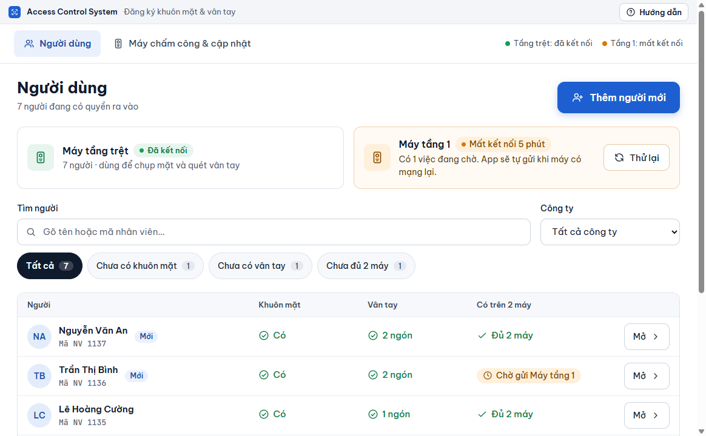
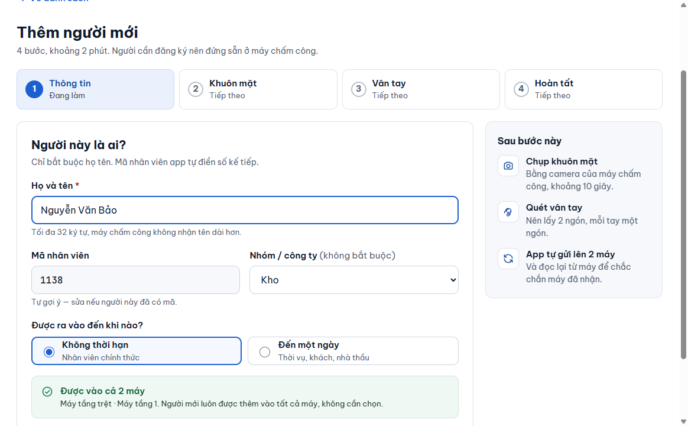
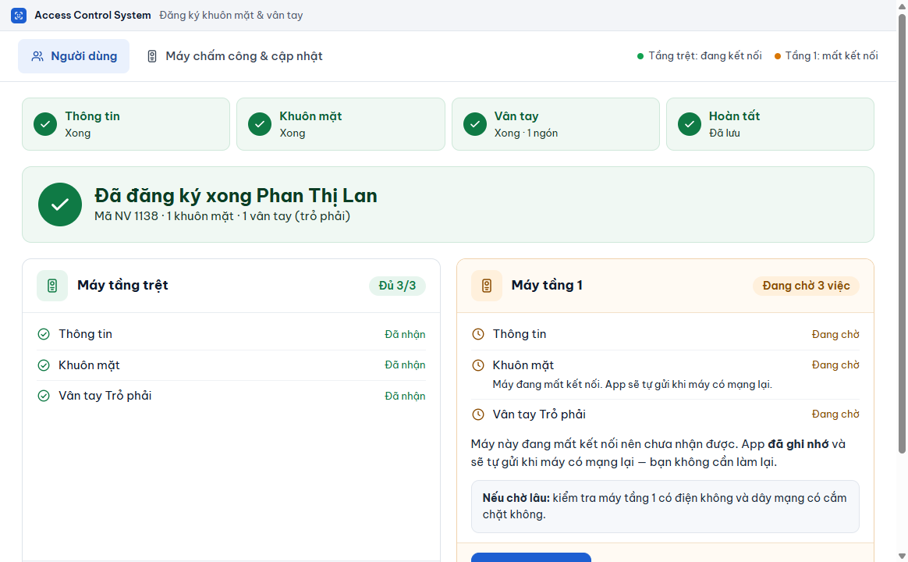

# Thêm người mới

**Ai làm:** người phụ trách đăng ký nhân viên (IT hoặc hành chính) · **Mất khoảng:** 2 phút cho mỗi người


**Trước khi bắt đầu:** người cần đăng ký nên đứng sẵn ở máy chấm công, vì khuôn mặt và vân tay được lấy ngay tại máy. Chuẩn bị họ tên, mã nhân viên (nếu người đó đã có mã) và ngày hết hạn (nếu là thời vụ, khách hoặc nhà thầu). Nên có giấy đồng ý của người đó, xem [Dữ liệu cá nhân và quyền riêng tư](../tham-khao/du-lieu-ca-nhan.md).




### Mở màn hình thêm người

Ở tab **Người dùng**, bấm **Thêm người mới**. Màn hình **Thêm người mới** hiện ra, phía trên có 4 bước: **Thông tin**, **Khuôn mặt**, **Vân tay**, **Hoàn tất**.

<figure><figcaption></figcaption></figure>



### Điền thông tin

Điền các ô sau. Ô có dấu \* là bắt buộc.

| Ô | Điền gì |
| --- | --- |
| **Họ và tên** \* | Tối đa 32 ký tự, vì máy chấm công không nhận tên dài hơn. |
| **Mã nhân viên** | Phần mềm tự điền số kế tiếp. Sửa lại nếu người này đã có mã. |
| **Nhóm / công ty** | Không bắt buộc. Chọn một công ty trong danh sách. Chưa có thì chọn **+ Nhóm mới…** rồi gõ tên vào ô hiện ra bên dưới. Họ tên bắt đầu bằng mã công ty và dấu chấm (ví dụ `ABC. Lan`) thì phần mềm tự chọn sẵn công ty `ABC`, nếu công ty đó đã có trong danh sách. |
| **Được ra vào đến khi nào?** | Chọn **Không thời hạn** (nhân viên chính thức) hoặc **Đến một ngày** (thời vụ, khách, nhà thầu). Chọn **Đến một ngày** thì nhập thêm ô **Hết hạn vào ngày**. |

Người mới luôn được thêm vào tất cả các máy. Khung xanh **Được vào cả 2 máy** liệt kê tên hai máy, bạn không cần chọn.

<figure><figcaption></figcaption></figure>



### Lưu và sang bước khuôn mặt

Bấm **Tiếp: Chụp khuôn mặt**. Phần mềm lưu người này vào bản gốc, xếp việc gửi xuống cả hai máy vào hàng đợi, rồi mở bước **Khuôn mặt**.



### Chụp khuôn mặt

Chụp hoặc chọn ảnh khuôn mặt, rồi bấm **Tiếp: Lấy vân tay**. Chi tiết ở [Chụp khuôn mặt](chup-khuon-mat.md).

Muốn bỏ qua, bấm **Bỏ qua bước này**. Bạn chụp lại sau được ở màn hình của người đó (xem [Sửa thông tin một người](sua-thong-tin.md)).



### Lấy vân tay

Chọn ngón trên hình hai bàn tay, đặt ngón lên đầu đọc của máy, rồi bấm **Tiếp: Hoàn tất**. Chi tiết ở [Lấy vân tay](lay-van-tay.md).

Muốn bỏ qua, bấm **Tiếp: Hoàn tất** mà không quét ngón nào. Ở màn hình **Hoàn tất**, bước **Vân tay** ghi **Bỏ qua**.



### Xem kết quả

Màn hình **Hoàn tất** hiện dòng **Đã đăng ký xong** kèm tên người đó, và một thẻ cho mỗi máy. Bấm **Về danh sách** để quay lại, hoặc **Thêm người khác** để đăng ký tiếp.

<figure><figcaption></figcaption></figure>




**Kết quả:** người mới có trong danh sách ở tab **Người dùng**, kèm nhãn **Mới** trong 7 ngày đầu. Phần mềm tự gửi xuống từng máy rồi đọc lại từ máy để kiểm tra. Trạng thái từng máy hiện ở bước **Hoàn tất** và ở [màn hình của người đó](tim-va-xem.md#doc-trang-thai-tren-may).


## Mã nhân viên gợi ý

- Phần mềm lấy số lớn nhất từng dùng rồi cộng 1, giữ nguyên số chữ số 0 ở đầu. Chưa có ai thì gợi ý `1001`.
- Mã đã xoá không bao giờ được gợi ý lại, để không lẫn với người cũ còn sót trên máy.
- Mã chỉ gồm chữ và số, tối đa 32 ký tự, và không trùng người khác.
- Mã không đổi được sau khi tạo. Nếu cần mã khác, tạo người mới.

## Màn hình Hoàn tất cho từng máy

Mỗi thẻ máy liệt kê **Thông tin**, **Khuôn mặt** và từng ngón vân tay, mỗi dòng có một trạng thái.

| Trạng thái trên thẻ | Nghĩa là gì | Bạn làm gì |
| --- | --- | --- |
| **Đủ 3/3** (thẻ xanh), từng dòng **Đã nhận** | Máy đã lưu và phần mềm đã đọc lại để kiểm tra. | Không cần làm gì. |
| **Đang chờ** 2 việc | Máy chưa nhận xong, thường vì mất kết nối. Phần mềm đã ghi nhớ và tự gửi khi máy có mạng lại. | Không cần làm lại. Nếu chờ lâu, kiểm tra máy có điện và dây mạng. |
| **Có lỗi** | Máy từ chối hoặc báo lỗi. Bấm **Chi tiết** để xem nguyên văn. | Bấm **Thử lại ngay**. Vẫn lỗi thì xem [Xử lý sự cố](../tham-khao/xu-ly-su-co.md). |

Máy đang dừng vì sai mật khẩu thì thẻ báo cách xử lý: mở tab **Máy chấm công & cập nhật** rồi bấm **Sửa mật khẩu**. Cách theo dõi việc gửi xuống máy nằm ở [Theo dõi việc gửi xuống máy](../may-cham-cong/theo-doi-gui-xuong-may.md).

## Lỗi thường gặp

Hãy nhập họ tên rồi bấm Tiếp.

Ô **Họ và tên** đang trống. Nhập họ tên rồi bấm **Tiếp: Chụp khuôn mặt** lại.

Mã nhân viên đã có người dùng.

Mã bạn nhập trùng một người khác. Nhập mã khác, hoặc xoá ô để dùng lại mã phần mềm gợi ý.

Mã này vừa xoá và đang chờ gỡ khỏi máy. Đợi máy gỡ xong hoặc dùng mã khác.

Một người dùng mã này vừa bị [xoá hẳn](xoa-han.md) và máy chưa gỡ xong (thường vì máy mất kết nối). Dùng mã khác, hoặc đợi máy gỡ xong rồi thêm lại.

Hãy chọn ngày hết hạn, hoặc chọn "Không thời hạn".

Bạn chọn **Đến một ngày** nhưng chưa nhập **Hết hạn vào ngày**. Chọn ngày, hoặc đổi lại thành **Không thời hạn**.

Tôi thoát giữa chừng, người này còn trong danh sách

Người được lưu ngay khi bạn bấm **Tiếp: Chụp khuôn mặt** ở bước đầu. Mở người đó từ danh sách để chụp mặt hoặc thêm vân tay sau, hoặc [xoá hẳn](xoa-han.md) nếu tạo nhầm.

