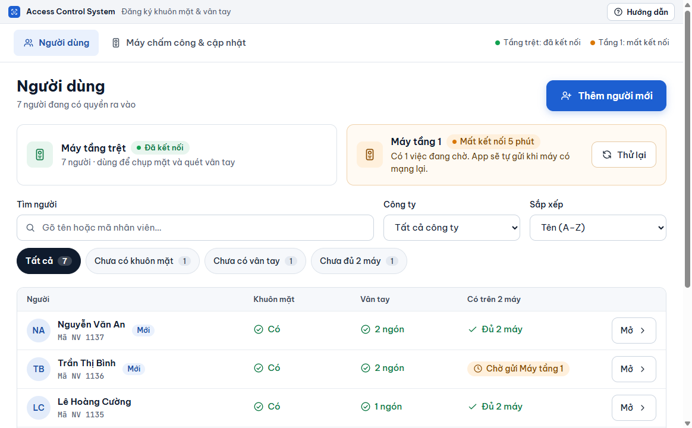
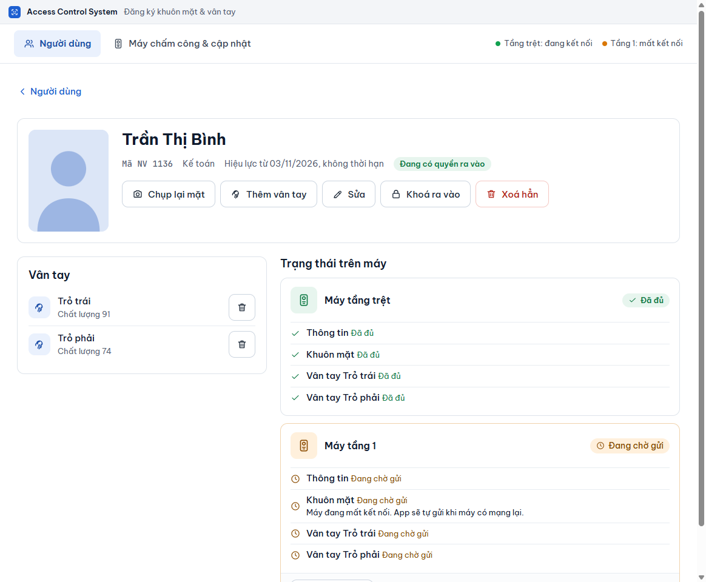
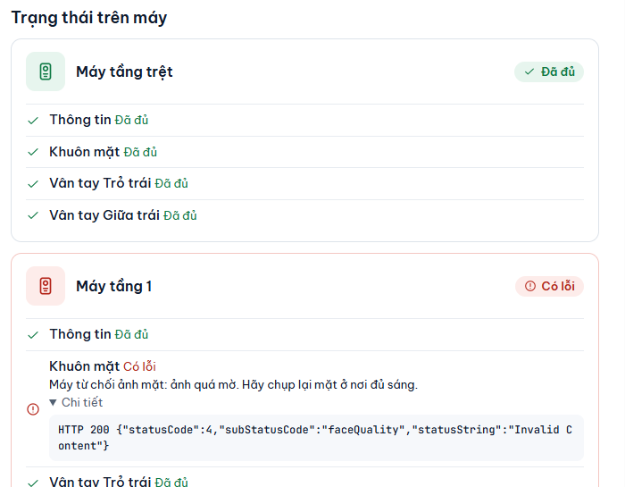

# Tìm và xem một người

**Ai làm:** người phụ trách đăng ký nhân viên · **Khi nào:** cần kiểm tra ai đó đã vào máy chưa, hoặc tìm người để sửa, khoá, xoá

## Tìm trong danh sách

Danh sách ở tab **Người dùng**, xếp theo tên. Mỗi hàng có cột **Người** (tên và mã nhân viên), **Khuôn mặt**, **Vân tay**, và cột cuối cho biết người đó đã có trên đủ các máy chưa.

<figure><figcaption></figcaption></figure>

1. Gõ vào ô **Tìm người** (gợi ý trong ô: **Gõ tên hoặc mã nhân viên…**). Danh sách thu hẹp ngay khi bạn ngừng gõ.
2. Muốn tìm tiếp, xoá chữ trong ô.

Tìm không phân biệt chữ hoa, chữ thường và dấu: gõ `nguyen` vẫn ra **Nguyễn Văn An**, gõ `duc` ra cả **Đức**. Gõ một phần mã (ví dụ `1137`) cũng tìm được.

## Lọc theo tình trạng

Các nút lọc nằm cạnh ô tìm kiếm, mỗi nút có một con số là số người thuộc nhóm đó.

| Nút lọc | Hiện những người nào |
| --- | --- |
| **Tất cả** | Mọi người, kể cả người đã khoá. |
| **Chưa có khuôn mặt** | Chưa có ảnh mặt trong phần mềm. |
| **Chưa có vân tay** | Chưa có ngón nào. |
| **Chưa đủ 2 máy** | Còn việc đang chờ hoặc bị lỗi ở ít nhất một máy. |
| **Đã khoá** | Người đã [khoá ra vào](khoa-va-mo-lai.md). Nút này chỉ hiện khi có người bị khoá. |

Ba nút giữa không tính người đã khoá.

## Lọc theo công ty

Ô **Công ty** cạnh ô tìm kiếm liệt kê các công ty kèm số người của mỗi công ty, và dòng **Chưa có nhóm** cho người chưa thuộc công ty nào. Chọn một công ty để chỉ xem người của công ty đó; chọn **Tất cả công ty** để xem lại cả danh sách.

Bộ lọc, ô **Công ty** và ô tìm kiếm dùng cùng lúc được. Không có ai khớp thì danh sách báo **Không có ai khớp. Thử bỏ bớt bộ lọc hoặc gõ tên khác.**


Danh sách xếp theo tên và chia trang, mặc định 50 người mỗi trang. Ở cuối bảng, chọn **Mỗi trang** là 20, 50, 100 hoặc **Tất cả**; bấm **Trước** / **Sau** để chuyển trang. Phần mềm nhớ lựa chọn này trên máy tính, và quay về trang 1 khi bạn đổi nhóm hoặc gõ tìm kiếm.


## Sắp xếp

Ô **Sắp xếp** cạnh ô **Công ty** đổi thứ tự danh sách:

| Lựa chọn | Thứ tự |
| --- | --- |
| **Tên (A–Z)** | Theo họ tên, mặc định. |
| **Mã NV tăng dần** | Theo mã nhân viên từ nhỏ đến lớn, so theo số (2, 10, 100). Dễ thấy mã nào còn trống. |
| **Mã NV giảm dần (mới nhất trước)** | Mã lớn nhất lên đầu, thường là người mới thêm gần đây. |

Phần mềm nhớ lựa chọn này trên máy tính, như ô **Mỗi trang**.

## Xem nhanh ảnh mặt và vân tay

Trong danh sách, chữ **Có** ở cột **Khuôn mặt** và chữ **2 ngón** (hay số ngón khác) ở cột **Vân tay** bấm được. Bấm vào, một hộp hiện ra ngay trên danh sách với:

- ảnh khuôn mặt phần mềm đang giữ;
- hình hai bàn tay, ngón đã lấy tô xanh, số nhỏ dưới ngón là chất lượng (trên 100).

Bấm **Mở hồ sơ** để sang màn hình của người đó, hoặc **Đóng** để ở lại danh sách.


Vân tay không có ảnh để xem. Máy chấm công chỉ lưu và gửi dữ liệu đã mã hoá của ngón tay, không lưu hình chụp ngón tay, nên phần mềm chỉ cho biết ngón nào đã lấy và chất lượng bao nhiêu.


## Đọc cột trạng thái trên máy

Cột cuối của mỗi hàng cho biết người đó đã tới các máy chưa.

| Nhãn | Nghĩa là gì |
| --- | --- |
| **Đủ 2 máy** | Cả hai máy đã nhận và phần mềm đã đọc lại để kiểm tra. |
| **Chờ gửi** kèm tên máy | Máy đó chưa nhận xong, thường vì mất kết nối. Phần mềm tự gửi khi máy có mạng lại. |
| **Lỗi gửi, mở để xem** | Máy từ chối hoặc báo lỗi. Mở người đó để xem chi tiết và thử lại. |
| **Đã khoá ra vào** | Người này đã bị khoá. |

Người đăng ký trong 7 ngày gần đây có thêm nhãn **Mới**. Dòng ngay dưới tiêu đề **Người dùng** cho biết số người đang có quyền ra vào (không tính người đã khoá).

Có người đã khoá hơn 6 tháng thì đầu màn hình hiện dải nhắc nên xoá hẳn, kèm liên kết **Xem danh sách đã khoá**. Xem [Xoá hẳn một người](xoa-han.md).

## Mở màn hình của một người

Bấm **Mở** ở cuối hàng. Màn hình của người đó gồm:

- Phía trên: ảnh khuôn mặt (hoặc chữ cái đầu và dòng **Chưa có ảnh mặt**), họ tên, mã nhân viên, nhóm, thời hạn **Hiệu lực từ** … đến … hoặc **không thời hạn**, và nhãn **Đang có quyền ra vào** hoặc **Đã khoá ra vào**.
- Hàng nút: **Chụp lại mặt**, **Thêm vân tay**, **Sửa**, **Khoá ra vào** (hoặc **Mở lại**), **Xoá hẳn**.
- Mục **Vân tay**: từng ngón đã lấy kèm **Chất lượng**.
- Mục **Trạng thái trên máy**: mỗi máy một thẻ.

Bấm **Người dùng** ở góc trên bên trái để quay lại danh sách.

<figure><figcaption></figcaption></figure>

## Đọc trạng thái trên máy

Mỗi thẻ máy có nhãn tổng ở góc phải: **Đã đủ**, **Đang chờ gửi** hoặc **Có lỗi**. Trong thẻ, từng dòng **Thông tin**, **Khuôn mặt** và từng ngón vân tay có trạng thái riêng cùng cách ghi trên.

| Nhãn trên thẻ | Bạn làm gì |
| --- | --- |
| **Đã đủ** | Không cần làm gì. |
| **Đang chờ gửi** | Chờ. Nếu máy mất kết nối, kiểm tra điện và dây mạng của máy. Bấm **Thử lại ngay** để gửi lại ngay. |
| **Có lỗi** | Đọc dòng lý do dưới tên mục, bấm **Chi tiết** để xem nguyên văn, rồi bấm **Thử lại ngay**. |

Một số dòng chờ có lời nhắc **chạy So khớp 2 máy**, ví dụ **Chưa có trên máy này — chạy So khớp 2 máy.** Điều này xảy ra khi phần mềm chưa có việc nào xếp hàng cho máy đó nhưng cũng chưa xác nhận được máy đã có dữ liệu, như sau khi thêm máy mới hoặc khôi phục sao lưu. Xem [So khớp 2 máy](../may-cham-cong/so-khop-2-may.md).

<figure><figcaption></figcaption></figure>


**Kết quả:** bạn biết người đó đã tới cả hai máy chưa, và nếu chưa thì máy nào, phần nào, vì sao. Cách phần mềm gửi và thử lại được giải thích ở [Theo dõi việc gửi xuống máy](../may-cham-cong/theo-doi-gui-xuong-may.md).


## Lỗi thường gặp

Tôi gõ tên mà danh sách trống

Kiểm tra nút lọc đang chọn: bộ lọc khác **Tất cả** thu hẹp danh sách cùng với ô tìm kiếm. Bấm **Tất cả** rồi tìm lại. Người đã khoá chỉ hiện ở **Tất cả** và **Đã khoá**.

Không thấy nút lọc Đã khoá

Nút này chỉ hiện khi có ít nhất một người đang bị khoá.

Danh sách báo lỗi thay vì hiện người

Phần mềm không đọc được dữ liệu. Thử mở lại phần mềm; nếu vẫn lỗi, xem [Xử lý sự cố](../tham-khao/xu-ly-su-co.md).

